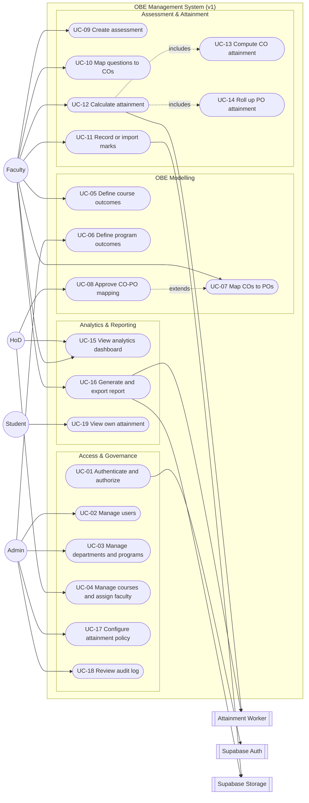

# OBE Management System — UML Use Case Modeling

**Session 5 Deliverable:** Use Case Diagram and Use Case Narratives

This document models the functional scope of the Outcome-Based Education (OBE) Management System from the outside in. It identifies the actors, the use cases they initiate, and the interactions between use cases. The scope is aligned with the problem statement in [EX2README.md](EX2README.md), the requirement context in [EX3README.md](EX3README.md), the SRS summary in [EX4README.md](EX4README.md), and the role workflow in [FLOW.md](FLOW.md).

## 1. Purpose and Scope

The use case model answers three questions:

1. **Who** uses the system? — Admin, HoD, Faculty, and Student, supported by the asynchronous Attainment Worker.
2. **What** can each actor accomplish? — from institutional setup and CO/PO modelling to marks entry, attainment calculation, and accreditation reporting.
3. **How** do use cases depend on each other? — which use cases include other behaviour or extend it under specific conditions.

The model covers the v1 scope (single IT department, local deployment) and deliberately leaves the v2/v3 multi-tenant administration flows as extensions rather than core use cases.

## 2. Actors

| Actor | Type | Description | Primary goals |
|---|---|---|---|
| **Admin** | Primary | System/OBE-cell administrator with institution-wide access | Configure departments, programs, POs, users, and attainment policy; review audit logs |
| **HoD** | Primary | Head of Department with department-scoped access | Manage department courses and faculty allocation, approve CO-PO mappings, monitor department attainment |
| **Faculty** | Primary | Teacher assigned to one or more courses | Define COs, map COs to POs, create assessments, tag questions, enter marks, calculate attainment, export course reports |
| **Student** | Primary | Student enrolled in a course | View own marks and personal CO/PO attainment |
| **Attainment Worker** | Secondary (system) | BullMQ worker that executes heavy or scheduled jobs | Compute attainment, generate report files, send completion notifications |
| **Supabase Auth** | Secondary (external system) | Identity provider issuing JWTs with role claims | Authenticate users and supply role/tenant claims |
| **Supabase Storage** | Secondary (external system) | Object storage for uploads and generated reports | Store Excel/CSV imports and Excel/PDF report files |

> The four human roles are enforced at three layers: Next.js middleware, Express API middleware, and PostgreSQL Row-Level Security (RLS). The Student role is included here because the v1 data model already links students to marks and attainment, even though student self-service is a thin read-only surface.

## 3. Use Case Diagram

### 3.1 Diagram notes

- The dashed `includes` arrows show behaviour that is always part of the base use case: a calculation cannot complete without computing CO attainment and then rolling it up to POs.
- `UC-08 Approve CO-PO mapping` **extends** `UC-07 Map COs to POs`: approval is an optional governance step triggered only when the department requires sign-off.
- Defining COs (UC-05) and POs (UC-06) are **preconditions** for mapping, not included behaviour; mapping does not re-run outcome definition.
- UC-19 reuses the analytics read model but is a distinct student-scoped use case, so it is not modelled as an include of UC-15.
- `UC-12 Calculate attainment` and `UC-16 Generate and export report` delegate long-running work to the **Attainment Worker** so the API remains responsive.
- Authentication is shown as a use case initiated by every human actor, but it is realized once by Supabase Auth and reused by all protected routes.

## 4. Use Case Catalog

| ID | Use case | Primary actor | Goal | Priority | Related module |
|---|---|---|---|---|---|
| UC-01 | Authenticate and authorize | All human actors | Establish a verified session with the correct role | Must | Auth & Users |
| UC-02 | Manage users | Admin | Create, import, activate, or deactivate user accounts | Must | Auth & Users |
| UC-03 | Manage departments and programs | Admin | Maintain the academic hierarchy | Must | Academic Structure |
| UC-04 | Manage courses and assign faculty | HoD | Create course offerings and allocate faculty | Must | Academic Structure |
| UC-05 | Define course outcomes | Faculty | Write measurable COs for an assigned course | Must | OBE Modelling |
| UC-06 | Define program outcomes | Admin | Maintain POs/PSOs for a program | Must | OBE Modelling |
| UC-07 | Map COs to POs | Faculty | Record CO × PO mapping weights (1/2/3) | Must | OBE Modelling |
| UC-08 | Approve CO-PO mapping | HoD | Review and approve a submitted mapping | Should | OBE Modelling |
| UC-09 | Create assessment | Faculty | Define an assessment and its maximum marks/weight | Must | Assessment & Marks |
| UC-10 | Map questions to COs | Faculty | Tag each question to one or more COs | Must | Assessment & Marks |
| UC-11 | Record or import marks | Faculty | Enter or bulk-import student marks per question | Must | Assessment & Marks |
| UC-12 | Calculate attainment | Faculty, HoD | Compute CO attainment and PO roll-up | Must | Attainment Engine |
| UC-13 | Compute CO attainment | System | Derive CO percentages from mapped marks and policy | Must | Attainment Engine |
| UC-14 | Roll up PO attainment | System | Weighted roll-up of CO attainment to POs | Must | Attainment Engine |
| UC-15 | View analytics dashboard | Faculty, HoD, Admin | Inspect course/department attainment trends | Should | Analytics & Reporting |
| UC-16 | Generate and export report | Faculty, HoD | Produce Excel/PDF attainment reports | Must | Analytics & Reporting |
| UC-17 | Configure attainment policy | Admin | Set target %, threshold %, and CIE/ESE weights | Must | OBE Configuration |
| UC-18 | Review audit log | Admin | Inspect data-changing operations for compliance | Should | Governance |
| UC-19 | View own attainment | Student | See personal marks and CO/PO attainment | Should | Analytics & Reporting |

## 5. Detailed Use Case Narratives

### UC-01 — Authenticate and Authorize

| Field | Detail |
|---|---|
| **Use case ID** | UC-01 |
| **Name** | Authenticate and authorize |
| **Primary actor** | Admin, HoD, Faculty, Student |
| **Supporting actors** | Supabase Auth |
| **Goal** | A verified user reaches only the pages and API resources permitted by their role |
| **Preconditions** | The user has an active account; Supabase Auth is reachable |
| **Trigger** | The user opens the application or attempts a protected action |

**Main success scenario**

1. The user opens `/login` and submits email and password.
2. The Next.js frontend calls Supabase Auth `signInWithPassword`.
3. Supabase Auth validates the credentials and returns a signed JWT (with `sub`, `role`, and `department_id` claims) plus a refresh token.
4. The frontend stores the session in an HTTP-only cookie; the role is read from the JWT claim.
5. Next.js middleware evaluates the requested route against the role and either allows or redirects the request.
6. Every subsequent Express API call carries the JWT in the `Authorization` header.
7. Express verifies the signature and role, then queries PostgreSQL, where RLS filters rows by department/program.

**Alternate / exception flows**

- **2a. Invalid credentials:** Supabase returns an authentication error; the UI shows a non-specific "invalid email or password" message and does not reveal whether the account exists.
- **3a. Disabled account:** Authentication fails or the session is rejected; the user is told to contact the administrator.
- **5a. Unauthorized route:** Middleware redirects to the role's landing page and logs the attempt.
- **6a. Expired token:** The API returns `401`; the client refreshes the token once and retries, otherwise redirects to login.
- **7a. RLS denies a row:** The API returns an empty result or `403` depending on the operation; the denial is written to the audit log.

**Postconditions**

- A valid session exists and the role context is available to the frontend, API, and database.
- No session is created for failed authentication.

**Business rules**

- BR-AUTH-01: Roles are `ADMIN`, `HOD`, `FACULTY`, and `STUDENT`.
- BR-AUTH-02: A HoD can access only their own department; Faculty only their assigned courses; Students only their own records.
- BR-AUTH-03: Authorization is enforced at all three layers; no layer trusts another layer's decision alone.

**Related requirements:** FR-AUTH-01, FR-AUTH-02, NFR-SEC-01, NFR-SEC-02.

---

### UC-05 — Define Course Outcomes

| Field | Detail |
|---|---|
| **Use case ID** | UC-05 |
| **Name** | Define course outcomes |
| **Primary actor** | Faculty (assigned to the course) |
| **Supporting actors** | — |
| **Goal** | A course has a complete, measurable set of COs suitable for mapping and assessment |
| **Preconditions** | The course exists and the faculty member is assigned to it |
| **Trigger** | Faculty opens **Course → Course Outcomes** |

**Main success scenario**

1. The system displays existing COs for the course, including code, statement, and Bloom level.
2. Faculty selects **Add CO**.
3. Faculty enters a CO code (e.g. `CO1`), a measurable statement, and the Bloom level.
4. The frontend validates required fields and statement length against the shared Zod schema.
5. The API checks that the course belongs to the authenticated faculty member (or an allowed HoD/Admin).
6. The API checks that the CO code is unique within the course.
7. The CO is saved and the CO count/coverage indicator is refreshed.
8. The action is recorded in the audit log.

**Alternate / exception flows**

- **3a. Missing or too-short statement:** The form highlights the field and blocks submission.
- **3b. Duplicate CO code:** The API returns `409 Conflict`; the UI asks for a different code.
- **3c. Course already used in an active assessment:** Editing the statement is allowed, but the CO cannot be deleted; the UI explains the dependency.
- **5a. Unauthorized course:** The API returns `403` and the attempt is audited.
- **6a. Maximum CO count reached:** If the institution enforces a limit, the API rejects the addition and suggests replacing an existing CO.

**Postconditions**

- The CO is persisted and available for CO-PO mapping, question tagging, and attainment.
- The course's CO version/updated timestamp changes.

**Business rules**

- BR-CO-01: A course has at least one CO before assessments can be mapped.
- BR-CO-02: CO codes are unique per course and follow `CO1…COn`.
- BR-CO-03: A CO statement must describe an observable, assessable outcome.
- BR-CO-04: A CO that is referenced by a question or attainment record cannot be hard-deleted.

**Related requirements:** FR-CO-01, FR-CO-02, FR-CO-03, FR-CO-04.

---

### UC-07 — Map COs to POs

| Field | Detail |
|---|---|
| **Use case ID** | UC-07 |
| **Name** | Map COs to POs |
| **Primary actor** | Faculty |
| **Supporting actors** | HoD (approval via UC-08) |
| **Goal** | Each CO is linked to one or more POs with a defensible weight |
| **Preconditions** | The course has COs (UC-05); the program has POs/PSOs (UC-06); the faculty member is assigned to the course |
| **Trigger** | Faculty opens **Course → CO-PO Matrix** |

**Main success scenario**

1. The system renders the CO × PO matrix for the course, pre-filled with any existing weights.
2. Faculty selects a cell and sets a weight of `1` (Low), `2` (Medium), or `3` (High); empty or `0` means no mapping.
3. The frontend shows per-CO and per-PO coverage summaries and warns about unmapped rows/columns.
4. Faculty saves the matrix.
5. The API validates each cell against the shared schema and verifies that CO/PO IDs belong to the same program context.
6. The API replaces the course's mapping set transactionally (delete removed links, upsert changed links).
7. The mapping is saved with a `DRAFT` or `PENDING_APPROVAL` status.
8. The audit log records the before/after matrix.

**Alternate / exception flows**

- **3a. CO has no PO mapping:** The UI warns but allows saving as draft.
- **3b. Weight outside 0–3:** The cell is rejected with an inline error.
- **5a. Cross-program CO/PO:** The API rejects the mapping with `422 Unprocessable Entity`.
- **7a. Department requires approval:** Saving automatically creates a pending approval item for the HoD; the matrix remains visible but cannot be used for final attainment until approved.

**Postconditions**

- The course's CO-PO mapping is persisted and versioned.
- If approval is required, the HoD sees a pending request.

**Business rules**

- BR-MAP-01: Weights are integers `0–3`; `0`/empty means no contribution.
- BR-MAP-02: Every CO should map to at least one PO; every PO need not be covered by every course.
- BR-MAP-03: Mapping changes after an approved attainment run require a new approval cycle.
- BR-MAP-04: The denominator for PO roll-up is the sum of weights, never the count of COs.

**Related requirements:** FR-MAP-01, FR-MAP-02, FR-MAP-03, FR-MAP-04.

---

### UC-08 — Approve CO-PO Mapping

| Field | Detail |
|---|---|
| **Use case ID** | UC-08 |
| **Name** | Approve CO-PO mapping |
| **Primary actor** | HoD |
| **Supporting actors** | Faculty (originator) |
| **Goal** | A submitted CO-PO matrix is reviewed and either approved or returned for correction |
| **Preconditions** | A mapping exists with status `PENDING_APPROVAL`; the HoD owns the department |
| **Trigger** | HoD opens **Approvals → CO-PO Mappings** |

**Main success scenario**

1. The system lists pending mappings with course, faculty, submission time, and summary counts.
2. HoD opens a mapping and reviews the matrix and coverage summary.
3. HoD selects **Approve**.
4. The API verifies HoD department scope and mapping status, then sets the status to `APPROVED` and records the approver and timestamp.
5. The faculty member sees the approved status and may proceed to final attainment.
6. The action is audited.

**Alternate / exception flows**

- **3a. HoD selects Return for correction:** The status becomes `CHANGES_REQUESTED` with a required comment; the faculty member is notified.
- **4a. Mapping changed since submission:** The API returns `409 Conflict`; the HoD reloads the latest version.
- **2a. HoD is also the submitting faculty:** The approval is blocked; an Admin must approve to preserve separation of duties.

**Postconditions**

- The mapping is `APPROVED` or `CHANGES_REQUESTED`.
- Approval metadata is available for accreditation evidence.

**Business rules**

- BR-APR-01: Only the HoD of the owning department or an Admin can approve.
- BR-APR-02: A user cannot approve their own mapping.
- BR-APR-03: Approval comments are mandatory for rejection/return.

**Related requirements:** FR-APR-01, FR-APR-02, NFR-SEC-04.

---

### UC-11 — Record or Import Marks

| Field | Detail |
|---|---|
| **Use case ID** | UC-11 |
| **Name** | Record or import marks |
| **Primary actor** | Faculty |
| **Supporting actors** | Supabase Storage, Attainment Worker |
| **Goal** | Student marks per question are available and valid for attainment calculation |
| **Preconditions** | An assessment exists with questions mapped to COs (UC-09, UC-10); students are enrolled; faculty is assigned |
| **Trigger** | Faculty opens **Assessment → Marks Entry** or uploads an Excel/CSV file |

**Main success scenario (manual entry)**

1. The system loads the marks grid: students as rows, questions as columns, with maximum marks from each question.
2. Faculty enters marks cell by cell; the grid validates numeric range and blank handling.
3. Faculty saves.
4. The API validates each mark against the question maximum and the enrollment list.
5. Marks are upserted in a single transaction.
6. The system marks the assessment as **Marks Complete** and invalidates the cached attainment for that course.
7. The audit log records the change summary.

**Main success scenario (bulk import)**

1. Faculty uploads a `.xlsx`/`.csv` file following the published template.
2. The API stores the file in Supabase Storage and enqueues an import job with the assessment ID and uploader.
3. The worker parses the file, resolves roll numbers to students, validates every row, and reports row-level errors.
4. If the file is fully valid, the worker upserts marks transactionally and marks the import `COMPLETED`.
5. The UI shows a summary (rows imported, rows skipped, errors) and the faculty can download an error report.
6. If the file has errors, no partial import is committed unless the faculty explicitly chooses **Import valid rows only**.

**Alternate / exception flows**

- **2a. Non-numeric or out-of-range mark:** The cell is highlighted; saving is blocked until corrected.
- **1a. Unknown roll number in import:** The row is rejected with the roll number and reason.
- **4a. Duplicate student rows:** The import is rejected as ambiguous; the faculty must remove duplicates.
- **3a. Worker failure:** The job is retried with backoff; after the retry limit the import is marked `FAILED` and the faculty is notified.
- **6a. Assessment marks already approved:** The API returns `409`; an authorized user must reopen the assessment.

**Postconditions**

- Marks are persisted for the assessment.
- Cached attainment is invalidated and may be recalculated.

**Business rules**

- BR-MARK-01: Waived/absent questions are `NULL`, not `0`; `0` is a real score.
- BR-MARK-02: A mark cannot exceed the question's maximum.
- BR-MARK-03: Only enrolled, active students can receive marks.
- BR-MARK-04: Bulk imports are all-or-nothing by default to avoid partial grade books.

**Related requirements:** FR-MARK-01, FR-MARK-02, FR-MARK-03, FR-MARK-04, NFR-PERF-02.

---

### UC-12 — Calculate Attainment

| Field | Detail |
|---|---|
| **Use case ID** | UC-12 |
| **Name** | Calculate attainment |
| **Primary actor** | Faculty, HoD |
| **Supporting actors** | Attainment Worker |
| **Goal** | Current CO and PO attainment percentages are computed and stored using the configured policy |
| **Preconditions** | Questions are mapped to COs; marks are complete; CO-PO mapping is approved (if the department requires it); an attainment policy exists (UC-17) |
| **Trigger** | User selects **Run Attainment** for a course, or a scheduled recalculation is triggered after a marks change |

**Main success scenario**

1. The user selects a course/assessment scope and confirms the run.
2. The API validates prerequisites and enqueues an attainment job with a snapshot of the policy and mapping version.
3. The worker loads marks, question-CO mappings, CO-PO mappings, and enrollments.
4. The worker computes student-level CO scores: `obtained / maximum` per mapped question, aggregated per CO.
5. The worker computes CO attainment using the configured method (threshold-based or average-based).
6. The worker computes PO attainment as `Σ(CO attainment × CO-PO weight) / Σ(weight)`.
7. Results are persisted with the policy version, mapping version, and calculation timestamp.
8. Cached dashboards are invalidated; the user is notified that the run is complete.
9. The audit log records who triggered the run and which policy/version was used.

**Alternate / exception flows**

- **2a. Marks incomplete:** The API blocks the run and lists assessments with missing marks.
- **2b. Mapping not approved:** If approval is mandatory, the run is blocked until approval.
- **3a. No enrolled students:** The run completes with a warning and zero denominators are reported as `N/A`, not `0%`.
- **4a. A CO has no mapped questions:** That CO is reported as `NOT_ASSESSED`; it is excluded from the PO denominator with a warning.
- **7a. Worker fails mid-run:** The transaction is rolled back; the previous attainment snapshot remains active.
- **8a. Duplicate run requested:** The API de-duplicates active jobs for the same scope and returns the existing job ID.

**Postconditions**

- A new attainment snapshot exists for the course.
- PO attainment is available for dashboards and reports.

**Business rules**

- BR-ATT-01: Attainment is never overwritten silently; historical snapshots are retained.
- BR-ATT-02: PO roll-up uses weights, not simple averages.
- BR-ATT-03: Threshold and target values come only from the active policy, never from hard-coded constants.
- BR-ATT-04: A CO with no assessment evidence is `NOT_ASSESSED`, not zero.

**Related requirements:** FR-ATT-01, FR-ATT-02, FR-ATT-03, FR-ATT-04, NFR-PERF-02, NFR-AUD-01.

---

### UC-16 — Generate and Export Report

| Field | Detail |
|---|---|
| **Use case ID** | UC-16 |
| **Name** | Generate and export report |
| **Primary actor** | Faculty, HoD |
| **Supporting actors** | Attainment Worker, Supabase Storage |
| **Goal** | A course or department attainment report is produced in Excel/PDF for review or accreditation |
| **Preconditions** | An attainment snapshot exists; the user has access to the report scope |
| **Trigger** | User selects **Export → Excel/PDF** from a dashboard |

**Main success scenario**

1. The user chooses report scope (course/department), format, and the attainment snapshot.
2. The API validates scope access and creates a report request with status `QUEUED`.
3. A worker renders the report from the selected snapshot, including CO/PO tables, mapping matrices, and weak-outcome highlights.
4. The worker stores the file in Supabase Storage and generates a signed, time-limited URL.
5. The report status becomes `READY`; the UI shows a download link and optional notification.
6. The download is logged for audit.

**Alternate / exception flows**

- **1a. No attainment snapshot:** The UI offers **Run attainment first** and blocks export.
- **2a. Unauthorized scope:** The API returns `403`.
- **3a. Rendering failure:** The job retries; if it still fails, status becomes `FAILED` with a support reference.
- **4a. Signed URL expired:** The user requests a fresh link; the file is not regenerated.

**Postconditions**

- A versioned report file exists and is linked to the snapshot used.
- Report generation metadata is available for audit.

**Business rules**

- BR-REP-01: Reports always reference the exact attainment snapshot and policy version.
- BR-REP-02: Faculty export only their courses; HoD exports only their department; Admin exports institution-wide.
- BR-REP-03: Report files expire from signed URLs but remain in storage per the retention policy.

**Related requirements:** FR-REP-01, FR-REP-02, FR-REP-03, NFR-SEC-03, NFR-AUD-01.

---

### UC-19 — View Own Attainment

| Field | Detail |
|---|---|
| **Use case ID** | UC-19 |
| **Name** | View own attainment |
| **Primary actor** | Student |
| **Supporting actors** | — |
| **Goal** | The student understands their marks and which outcomes are strong or weak |
| **Preconditions** | The student is enrolled and authenticated; marks/attainment are published |
| **Trigger** | Student opens **My Courses → Attainment** |

**Main success scenario**

1. The system lists the student's enrolled courses.
2. The student selects a course.
3. The API returns only rows owned by that student (enforced by RLS and a `student_id` filter).
4. The UI shows marks per assessment and personal CO attainment, with weak/strong indicators.
5. The student can download a personal PDF summary if enabled.

**Alternate / exception flows**

- **3a. Results not published:** The UI shows "results pending" instead of partial data.
- **3b. No attainment snapshot:** The UI explains that the faculty has not run attainment yet.
- **5a. Export disabled by policy:** The download action is hidden.

**Postconditions**

- The student has read-only visibility of their own data; no writes occur.

**Business rules**

- BR-STU-01: Students can never see another student's marks.
- BR-STU-02: Students see published snapshots only.
- BR-STU-03: Student access is read-only in v1.

**Related requirements:** FR-STU-01, NFR-SEC-01, NFR-SEC-02.

## 6. Use Case Relationships and Rationale

| Relationship | From → To | Type | Rationale |
|---|---|---|---|
| R-01 | UC-12 → UC-13 | `<<include>>` | A calculation request always computes CO attainment first |
| R-02 | UC-12 → UC-14 | `<<include>>` | PO attainment is always derived from the CO results |
| R-03 | UC-05 → UC-07 | precondition | Mapping cannot be performed without defined COs |
| R-04 | UC-06 → UC-07 | precondition | Mapping cannot be performed without defined POs/PSOs |
| R-05 | UC-08 → UC-07 | `<<extend>>` | Approval is optional and department-policy driven |
| R-06 | UC-15 ↔ UC-19 | shared read model | Student view reuses the analytics read model with a student scope |
| R-07 | UC-16 → UC-12 | precondition | A report requires an attainment snapshot; running attainment is not silently triggered |

## 7. Traceability to the SRS and Flows

| SRS area | Covered by |
|---|---|
| Authentication and RBAC | UC-01, UC-02, UC-18 |
| Academic structure | UC-03, UC-04 |
| CO/PO management and mapping | UC-05, UC-06, UC-07, UC-08 |
| Assessment and question mapping | UC-09, UC-10 |
| Marks management and import | UC-11 |
| Attainment engine | UC-12, UC-13, UC-14, UC-17 |
| Analytics and reporting | UC-15, UC-16, UC-19 |
| Audit and governance | UC-08, UC-18 |

The core faculty workflow from [FLOW.md](FLOW.md) maps directly to UC-05 → UC-07 → UC-09 → UC-10 → UC-11 → UC-12 → UC-16.

## 8. Non-Functional Constraints on Use Cases

| Constraint | Affected use cases | Design implication |
|---|---|---|
| Reads respond within 2 s under normal load | UC-13, UC-15, UC-19 | Precompute attainment snapshots; cache dashboards in Redis |
| Bulk operations and reports run asynchronously | UC-11, UC-12, UC-16 | Use BullMQ jobs and job-status polling; never block the HTTP request |
| Role isolation at API and database layers | All use cases | JWT role claims + Express middleware + PostgreSQL RLS |
| Every data-changing operation is auditable | UC-02…UC-17 | Central audit interceptor/observer; append-only audit table |
| Reports must reference a reproducible snapshot | UC-16 | Persist policy version and mapping version with each attainment run |

## 9. Assumptions and Open Questions

**Assumptions**

- One faculty member is the primary owner of a course offering in v1; co-teaching is a v2 extension.
- Attainment is calculated per course offering, not per student cohort across years.
- HoD approval of CO-PO mappings is configurable; if disabled, UC-08 is skipped.
- Students are provisioned by Admin import; self-registration is out of scope.

**Open questions**

- Should CO attainment be threshold-based (percentage of students above a target) or average-score-based? Both are modelled through UC-17 and the Strategy pattern in Session 9.
- What is the official accreditation export format (NBA/ABET) for v2?
- Should students be able to raise a marks discrepancy request? This would add a v2 use case, not part of v1.
