# OBE Management System — UML Class Diagram Design

**Session 6 Deliverable:** Object-Oriented Analysis and UML Class Diagram

This document identifies the domain classes of the Outcome-Based Education (OBE) Management System, their attributes, methods, and relationships. It builds directly on the actors and use cases defined in [EX5README.md](EX5README.md) and the SRS scope in [EX4README.md](EX4README.md).

## 1. Purpose and Modelling Scope

The class model describes the **domain and analysis classes** needed to support the v1 workflow:

- institutional structure (departments, programs, courses, users);
- OBE modelling (COs, POs/PSOs, CO-PO mappings);
- assessment and marks (assessments, questions, question-CO tags, student marks);
- attainment (policy, snapshots, CO/PO results);
- reporting and governance (reports, audit log).

It intentionally excludes framework classes such as Next.js pages, Express routers, Prisma clients, and BullMQ job objects. Those belong to the architecture and design-pattern discussion in Session 9. The model is therefore a **logical domain model** that can be mapped to the physical Prisma schema.

## 2. Class Diagram

```mermaid
classDiagram
    direction LR

    class User {
        <<abstract>>
        +UUID id
        +String authId
        +String name
        +String email
        +Role role
        +UUID departmentId
        +Boolean isActive
        +login() Boolean
        +hasPermission(action) Boolean
    }

    class Admin {
        +manageUsers() void
        +configurePolicy() void
        +reviewAuditLog() AuditLog[]
    }

    class HoD {
        +approveMapping(mappingId) void
        +viewDepartmentAnalytics() Dashboard
    }

    class Faculty {
        +String employeeId
        +assignedCourses() List~Course~
        +defineCO(courseId, co) CourseOutcome
        +runAttainment(courseId) AttainmentSnapshot
    }

    class Student {
        +String rollNo
        +UUID programId
        +viewOwnAttainment(courseId) COAttainment[]
    }

    class Department {
        +UUID id
        +String code
        +String name
        +programs() List~Program~
    }

    class Program {
        +UUID id
        +String code
        +String name
        +UUID departmentId
        +courses() List~Course~
        +outcomes() List~ProgramOutcome~
    }

    class Course {
        +UUID id
        +String code
        +String title
        +Int credits
        +Int semester
        +String academicYear
        +UUID programId
        +UUID facultyId
        +defineCO(co) CourseOutcome
        +createAssessment(assessment) Assessment
        +latestSnapshot() AttainmentSnapshot
    }

    class CourseOutcome {
        +UUID id
        +String code
        +String statement
        +BloomLevel bloomLevel
        +UUID courseId
        +Boolean isActive
        +mapTo(poId, weight) COPOMapping
    }

    class ProgramOutcome {
        +UUID id
        +String code
        +String statement
        +OutcomeType type
        +UUID programId
        +isMappedBy(coId) Boolean
    }

    class COPOMapping {
        +UUID id
        +UUID courseOutcomeId
        +UUID programOutcomeId
        +Int weight
        +MappingStatus status
        +UUID approvedBy
        +DateTime approvedAt
        +approve(approverId) void
        +reject(comment) void
    }

    class Assessment {
        +UUID id
        +String title
        +AssessmentType type
        +Float maxMarks
        +Float weightPercent
        +UUID courseId
        +AssessmentStatus status
        +totalQuestions() Int
        +isMarksComplete() Boolean
    }

    class Question {
        +UUID id
        +String number
        +Float maxMarks
        +UUID assessmentId
        +mapToCO(coId) QuestionCOMapping
    }

    class QuestionCOMapping {
        +UUID id
        +UUID questionId
        +UUID courseOutcomeId
        +Float share
    }

    class Enrollment {
        +UUID id
        +UUID studentId
        +UUID courseId
        +String semester
        +EnrollmentStatus status
    }

    class Mark {
        +UUID id
        +UUID studentId
        +UUID questionId
        +Float obtainedMarks
        +UUID enteredBy
        +DateTime updatedAt
        +isValid(maxMarks) Boolean
    }

    class AttainmentPolicy {
        +UUID id
        +String name
        +AttainmentMethod method
        +Float targetPercent
        +Float thresholdPercent
        +Float cieWeight
        +Float eseWeight
        +Boolean approvalRequired
        +Boolean isActive
    }

    class AttainmentSnapshot {
        +UUID id
        +UUID courseId
        +UUID policyId
        +Int mappingVersion
        +UUID calculatedBy
        +DateTime calculatedAt
        +SnapshotStatus status
        +coResults() List~COAttainment~
        +poResults() List~POAttainment~
    }

    class COAttainment {
        +UUID id
        +UUID snapshotId
        +UUID courseOutcomeId
        +Float percent
        +Float averageScore
        +Int studentsAboveThreshold
        +Int totalStudents
        +AttainmentStatus status
    }

    class POAttainment {
        +UUID id
        +UUID snapshotId
        +UUID programOutcomeId
        +Float percent
        +Float weightedDenominator
        +AttainmentStatus status
    }

    class Report {
        +UUID id
        +ReportType type
        +ReportScope scope
        +ReportFormat format
        +ReportStatus status
        +String fileUrl
        +UUID requestedBy
        +UUID snapshotId
        +DateTime createdAt
        +markReady(url) void
        +markFailed(reason) void
    }

    class AuditLog {
        +UUID id
        +UUID userId
        +String action
        +String entityType
        +UUID entityId
        +JSON before
        +JSON after
        +String ipAddress
        +DateTime timestamp
    }

    class Role {
        <<enumeration>>
        ADMIN
        HOD
        FACULTY
        STUDENT
    }
    class BloomLevel {
        <<enumeration>>
        REMEMBER
        UNDERSTAND
        APPLY
        ANALYZE
        EVALUATE
        CREATE
    }
    class OutcomeType {
        <<enumeration>>
        PO
        PSO
    }
    class MappingStatus {
        <<enumeration>>
        DRAFT
        PENDING_APPROVAL
        APPROVED
        CHANGES_REQUESTED
    }
    class AssessmentType {
        <<enumeration>>
        QUIZ
        ASSIGNMENT
        MID_SEMESTER
        LAB_EXAM
        END_SEMESTER
    }
    class AssessmentStatus {
        <<enumeration>>
        DRAFT
        MARKS_PENDING
        MARKS_COMPLETE
        LOCKED
    }
    class EnrollmentStatus {
        <<enumeration>>
        ACTIVE
        DROPPED
        COMPLETED
    }
    class AttainmentMethod {
        <<enumeration>>
        THRESHOLD
        AVERAGE
    }
    class SnapshotStatus {
        <<enumeration>>
        RUNNING
        COMPLETED
        FAILED
    }
    class AttainmentStatus {
        <<enumeration>>
        ATTAINED
        WEAK
        NOT_ASSESSED
    }
    class ReportType {
        <<enumeration>>
        COURSE_ATTAINMENT
        DEPARTMENT_ATTAINMENT
        STUDENT_SUMMARY
    }
    class ReportScope {
        <<enumeration>>
        COURSE
        DEPARTMENT
        INSTITUTION
    }
    class ReportFormat {
        <<enumeration>>
        XLSX
        PDF
    }
    class ReportStatus {
        <<enumeration>>
        QUEUED
        PROCESSING
        READY
        FAILED
    }

    User <|-- Admin
    User <|-- HoD
    User <|-- Faculty
    User <|-- Student

    Department "1" --> "*" Program : offers
    Program "1" --> "*" Course : contains
    Program "1" --> "*" ProgramOutcome : defines
    Faculty "1" --> "*" Course : teaches
    Course "1" *-- "*" CourseOutcome : defines
    Course "1" *-- "*" Assessment : contains
    Assessment "1" *-- "*" Question : contains

    CourseOutcome "*" --> "*" ProgramOutcome : mapped by
    COPOMapping "*" --> "1" CourseOutcome : links
    COPOMapping "*" --> "1" ProgramOutcome : links
    QuestionCOMapping "*" --> "1" Question : tags
    QuestionCOMapping "*" --> "1" CourseOutcome : tags

    Student "1" --> "*" Enrollment : registers
    Course "1" --> "*" Enrollment : has
    Student "1" --> "*" Mark : receives
    Question "1" --> "*" Mark : scored on

    Course "1" --> "*" AttainmentSnapshot : produces
    AttainmentPolicy "1" --> "*" AttainmentSnapshot : governs
    AttainmentSnapshot "1" *-- "*" COAttainment : contains
    AttainmentSnapshot "1" *-- "*" POAttainment : contains
    COAttainment "*" --> "1" CourseOutcome : measures
    POAttainment "*" --> "1" ProgramOutcome : aggregates

    User "1" --> "*" Report : requests
    AttainmentSnapshot "1" --> "*" Report : supplies
    User "1" --> "*" AuditLog : generates
```

## 3. Class Catalog

### 3.1 People and Institutional Structure

| Class | Responsibility | Key attributes | Key methods | Related use cases |
|---|---|---|---|---|
| **User** | Abstract identity and authorization root | `id`, `authId`, `email`, `role`, `departmentId`, `isActive` | `login()`, `hasPermission()` | UC-01, UC-02 |
| **Admin** | Institution-wide configuration and governance | inherits `User` | `manageUsers()`, `configurePolicy()`, `reviewAuditLog()` | UC-02, UC-03, UC-06, UC-17, UC-18 |
| **HoD** | Department-scoped management and approval | inherits `User` | `approveMapping()`, `viewDepartmentAnalytics()` | UC-04, UC-08, UC-15 |
| **Faculty** | Course-level OBE authoring and assessment | `employeeId`, inherits `User` | `defineCO()`, `runAttainment()` | UC-05, UC-07, UC-09…UC-12, UC-16 |
| **Student** | Read-only view of own academic results | `rollNo`, `programId`, inherits `User` | `viewOwnAttainment()` | UC-19 |
| **Department** | Organizational unit owning programs | `id`, `code`, `name` | `programs()` | UC-03, UC-04 |
| **Program** | Degree program owning courses and POs | `id`, `code`, `name`, `departmentId` | `courses()`, `outcomes()` | UC-03, UC-06 |
| **Course** | Course offering in an academic year | `code`, `title`, `credits`, `semester`, `facultyId` | `defineCO()`, `createAssessment()`, `latestSnapshot()` | UC-04, UC-05, UC-09, UC-12 |
| **Enrollment** | Join between student and course | `studentId`, `courseId`, `semester`, `status` | — | UC-11, UC-19 |

### 3.2 OBE Modelling

| Class | Responsibility | Key attributes | Key methods | Related use cases |
|---|---|---|---|---|
| **CourseOutcome** | Measurable outcome for one course | `code`, `statement`, `bloomLevel`, `courseId`, `isActive` | `mapTo()` | UC-05, UC-07 |
| **ProgramOutcome** | PO or PSO defined for a program | `code`, `statement`, `type`, `programId` | `isMappedBy()` | UC-06, UC-07 |
| **COPOMapping** | Weighted many-to-many link between CO and PO | `courseOutcomeId`, `programOutcomeId`, `weight`, `status` | `approve()`, `reject()` | UC-07, UC-08 |

### 3.3 Assessment and Marks

| Class | Responsibility | Key attributes | Key methods | Related use cases |
|---|---|---|---|---|
| **Assessment** | Graded activity inside a course | `title`, `type`, `maxMarks`, `weightPercent`, `status` | `totalQuestions()`, `isMarksComplete()` | UC-09, UC-11, UC-12 |
| **Question** | Individual item in an assessment | `number`, `maxMarks`, `assessmentId` | `mapToCO()` | UC-10 |
| **QuestionCOMapping** | Tags a question to one or more COs | `questionId`, `courseOutcomeId`, `share` | — | UC-10, UC-12 |
| **Mark** | Score obtained by a student on a question | `studentId`, `questionId`, `obtainedMarks`, `enteredBy` | `isValid()` | UC-11, UC-12 |

### 3.4 Attainment and Reporting

| Class | Responsibility | Key attributes | Key methods | Related use cases |
|---|---|---|---|---|
| **AttainmentPolicy** | Configurable calculation rules | `method`, `targetPercent`, `thresholdPercent`, `cieWeight`, `eseWeight` | — | UC-12, UC-17 |
| **AttainmentSnapshot** | Immutable result of one calculation run | `courseId`, `policyId`, `mappingVersion`, `calculatedAt`, `status` | `coResults()`, `poResults()` | UC-12, UC-15, UC-16 |
| **COAttainment** | Per-CO result inside a snapshot | `percent`, `averageScore`, `studentsAboveThreshold` | — | UC-12, UC-15, UC-19 |
| **POAttainment** | Per-PO roll-up inside a snapshot | `percent`, `weightedDenominator`, `status` | — | UC-12, UC-15 |
| **Report** | Asynchronous export request and file metadata | `type`, `scope`, `format`, `status`, `fileUrl` | `markReady()`, `markFailed()` | UC-16 |
| **AuditLog** | Append-only record of data changes | `userId`, `action`, `entityType`, `before`, `after` | — | UC-01, UC-08, UC-18 |

## 4. Relationship Analysis

| Relationship | Type | Multiplicity | Why it is modelled this way |
|---|---|---|---|
| `User → Admin/HoD/Faculty/Student` | Generalization | 1 : 1 subtype | Roles share identity/auth behaviour but expose different operations. The physical schema can use a single `users` table with a `role` discriminator. |
| `Department → Program` | Association | 1 : * | A department offers many programs; a program belongs to one department. |
| `Program → Course` | Association | 1 : * | Courses are owned by a program; the same course code may recur in another academic year as a new offering. |
| `Faculty → Course` | Association | 1 : * | One faculty member teaches many courses; each course has one owner in v1 (co-teaching is v2). |
| `Course → CourseOutcome` | Composition | 1 : * | COs have no meaning outside their course and are deleted with it only if unreferenced. |
| `Course → Assessment` | Composition | 1 : * | Assessments belong to a course offering. |
| `Assessment → Question` | Composition | 1 : * | Questions cannot exist without their assessment. |
| `CourseOutcome ↔ ProgramOutcome` | Many-to-many via `COPOMapping` | * : * | Mapping carries its own attributes (`weight`, `status`, `approvedBy`), so an association class is required. |
| `Question ↔ CourseOutcome` | Many-to-many via `QuestionCOMapping` | * : * | A question may test more than one CO, and a CO is tested by many questions. `share` supports partial credit allocation. |
| `Student ↔ Course` | Many-to-many via `Enrollment` | * : * | Enrollment carries semester and status; it also scopes which marks are valid. |
| `Student → Mark` | Association | 1 : * | A student receives many marks. |
| `Question → Mark` | Association | 1 : * | A question accumulates one mark per student. |
| `Course → AttainmentSnapshot` | Association | 1 : * | Multiple historical snapshots preserve reproducibility. |
| `AttainmentPolicy → AttainmentSnapshot` | Association | 1 : * | Every snapshot records the exact policy used. |
| `AttainmentSnapshot → COAttainment` | Composition | 1 : * | CO results are owned by one snapshot and are immutable. |
| `AttainmentSnapshot → POAttainment` | Composition | 1 : * | PO results are derived and stored with their snapshot. |
| `User → Report` | Association | 1 : * | Reports are requested by a user and must remain traceable. |
| `AttainmentSnapshot → Report` | Association | 1 : * | A report always cites the snapshot it was rendered from. |
| `User → AuditLog` | Association | 1 : * | Every changing action is attributable to a user. |

### 4.1 Why composition is used

- **COs, assessments, and questions** are lifecycle-dependent on their parent; deleting a course offering should cascade or be blocked explicitly.
- **Attainment results** must never outlive their snapshot: snapshots are the historical record, and result rows are read-only.
- **Mappings** are association classes, not compositions, because a CO and a PO both exist independently.

## 5. Key Design Decisions

### 5.1 Inheritance in the model, single table in the database

The model uses `User` generalization because each role exposes different behaviour. The physical PostgreSQL schema can use one `users` table with a `role` column and nullable role-specific columns (`employee_id`, `roll_no`), or separate profile tables. This keeps authentication simple while preserving the analysis intent. The trade-off is documented in Session 8 (function-oriented vs object-oriented design).

### 5.2 Explicit mapping classes instead of hidden join tables

`COPOMapping` and `QuestionCOMapping` are first-class classes because they carry attributes that matter to attainment:

- `weight` drives the PO roll-up denominator;
- `share` allows one question's marks to be split across multiple COs;
- `status`, `approvedBy`, and `approvedAt` provide accreditation evidence.

### 5.3 Snapshot pattern for reproducibility

`AttainmentSnapshot` freezes the inputs and outputs of a calculation run:

- the **policy version** (`policyId`),
- the **mapping version** (`mappingVersion`),
- the **calculatedBy** user and timestamp.

This makes reports defensible even after COs, mappings, or policies change. It also gives the attainment engine a natural transaction boundary.

### 5.4 Derived vs stored data

CO and PO percentages are **stored** inside snapshots rather than computed on every dashboard read. This is a deliberate performance decision (NFR-PERF-01) and allows historical comparison. The live calculation logic remains in the domain service, not in the entity.

### 5.5 Nullable marks are meaningful

`Mark.obtainedMarks` is nullable. `NULL` means absent/waived; `0` is a genuine zero score. The attainment engine must exclude `NULL` from denominators rather than treating it as zero (BR-MARK-01).

### 5.6 Auditability

`AuditLog` references the acting `User` and stores `before`/`after` JSON. It is append-only: no update or delete operations are exposed on this class. Passwords and tokens are never stored in the audit payload.

## 6. Constraints and Invariants

| ID | Invariant | Enforced by |
|---|---|---|
| INV-01 | A CO code is unique within its course | Database unique constraint + API validation |
| INV-02 | A CO-PO weight is an integer from 1 to 3, or the mapping is absent | Zod schema + database check constraint |
| INV-03 | A mark is between 0 and the question's maximum | API validation + database check |
| INV-04 | A student can have at most one mark per question | Unique `(studentId, questionId)` |
| INV-05 | A student can be enrolled only once per course offering | Unique `(studentId, courseId, semester)` |
| INV-06 | An attainment snapshot is immutable after completion | Service layer disallows updates; new runs create new snapshots |
| INV-07 | PO attainment uses the sum of mapping weights as denominator | Attainment engine + tests |
| INV-08 | An approved mapping cannot be edited without a new approval cycle | `COPOMapping.status` state machine |
| INV-09 | A user cannot approve their own mapping | Authorization rule in the approval service |
| INV-10 | Audit entries are append-only | No update/delete endpoints; database permissions |

## 7. Traceability to Use Cases

| Use case | Classes involved |
|---|---|
| UC-01 Authenticate and authorize | `User`, `Role`, `AuditLog` |
| UC-02 Manage users | `User`, `Admin`, `Department`, `AuditLog` |
| UC-03 Manage departments/programs | `Department`, `Program` |
| UC-04 Manage courses/assign faculty | `Program`, `Course`, `Faculty` |
| UC-05 Define COs | `Course`, `CourseOutcome` |
| UC-06 Define POs | `Program`, `ProgramOutcome` |
| UC-07 Map COs to POs | `CourseOutcome`, `ProgramOutcome`, `COPOMapping` |
| UC-08 Approve mapping | `COPOMapping`, `HoD`, `AuditLog` |
| UC-09 Create assessment | `Course`, `Assessment` |
| UC-10 Map questions to COs | `Question`, `CourseOutcome`, `QuestionCOMapping` |
| UC-11 Record/import marks | `Enrollment`, `Mark`, `Assessment`, `Question` |
| UC-12 Calculate attainment | `AttainmentSnapshot`, `COAttainment`, `POAttainment`, `AttainmentPolicy` |
| UC-15 View analytics | `AttainmentSnapshot`, `COAttainment`, `POAttainment` |
| UC-16 Export report | `Report`, `AttainmentSnapshot` |
| UC-17 Configure policy | `AttainmentPolicy`, `Admin` |
| UC-18 Review audit log | `AuditLog`, `Admin` |
| UC-19 View own attainment | `Student`, `Enrollment`, `COAttainment` |

## 8. Mapping to the Physical Schema

| Logical class | Physical table (planned) | Notes |
|---|---|---|
| `User` + subclasses | `users` | Single table, `role` enum, nullable `employee_id`/`roll_no` |
| `Department` | `departments` | Unique `code` |
| `Program` | `programs` | FK `department_id` |
| `Course` | `courses` | FK `program_id`, `faculty_id`, `academic_year` |
| `CourseOutcome` | `course_outcomes` | Unique `(course_id, code)` |
| `ProgramOutcome` | `program_outcomes` | Unique `(program_id, code)` |
| `COPOMapping` | `co_po_mappings` | Unique `(course_outcome_id, program_outcome_id)` |
| `Assessment` | `assessments` | FK `course_id` |
| `Question` | `questions` | FK `assessment_id` |
| `QuestionCOMapping` | `question_co_mappings` | Unique `(question_id, course_outcome_id)` |
| `Enrollment` | `enrollments` | Unique `(student_id, course_id, semester)` |
| `Mark` | `marks` | Unique `(student_id, question_id)` |
| `AttainmentPolicy` | `attainment_policies` | Only one active policy per scope |
| `AttainmentSnapshot` | `attainment_snapshots` | Immutable after completion |
| `COAttainment` | `co_attainments` | FK `snapshot_id`, `course_outcome_id` |
| `POAttainment` | `po_attainments` | FK `snapshot_id`, `program_outcome_id` |
| `Report` | `reports` | Status machine + signed URL metadata |
| `AuditLog` | `audit_logs` | Append-only, indexed by `entity_type`, `entity_id`, `timestamp` |

## 9. Assumptions

- A course offering is identified by course + academic year + semester; the logical `Course` class represents that offering.
- One active attainment policy applies to a department at a time; institution-wide policies are a v2 concern.
- CO-PO approval is configurable and can be disabled for a department that does not require it.
- Student self-registration does not exist; `Student` rows are provisioned by Admin import.
- The model does not include notification preferences or announcement classes; those are outside the v1 scope.
