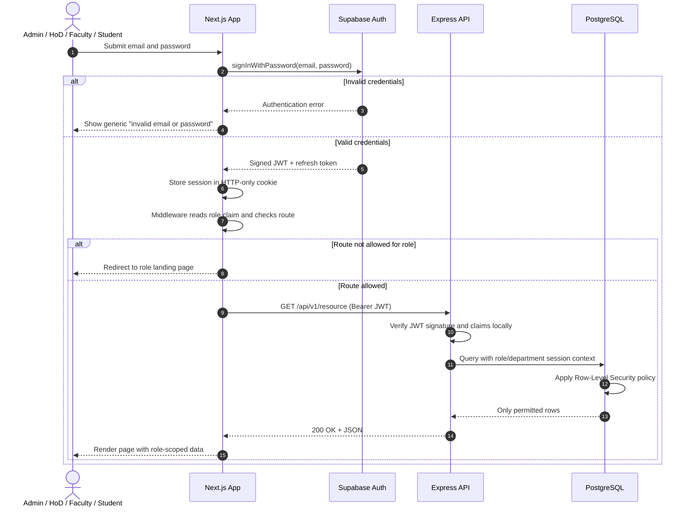
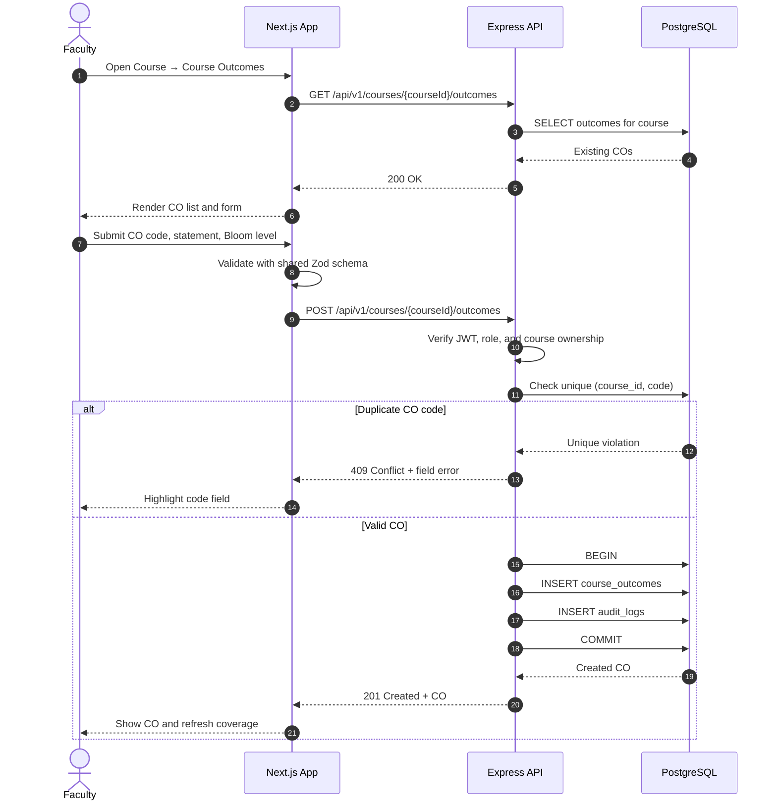
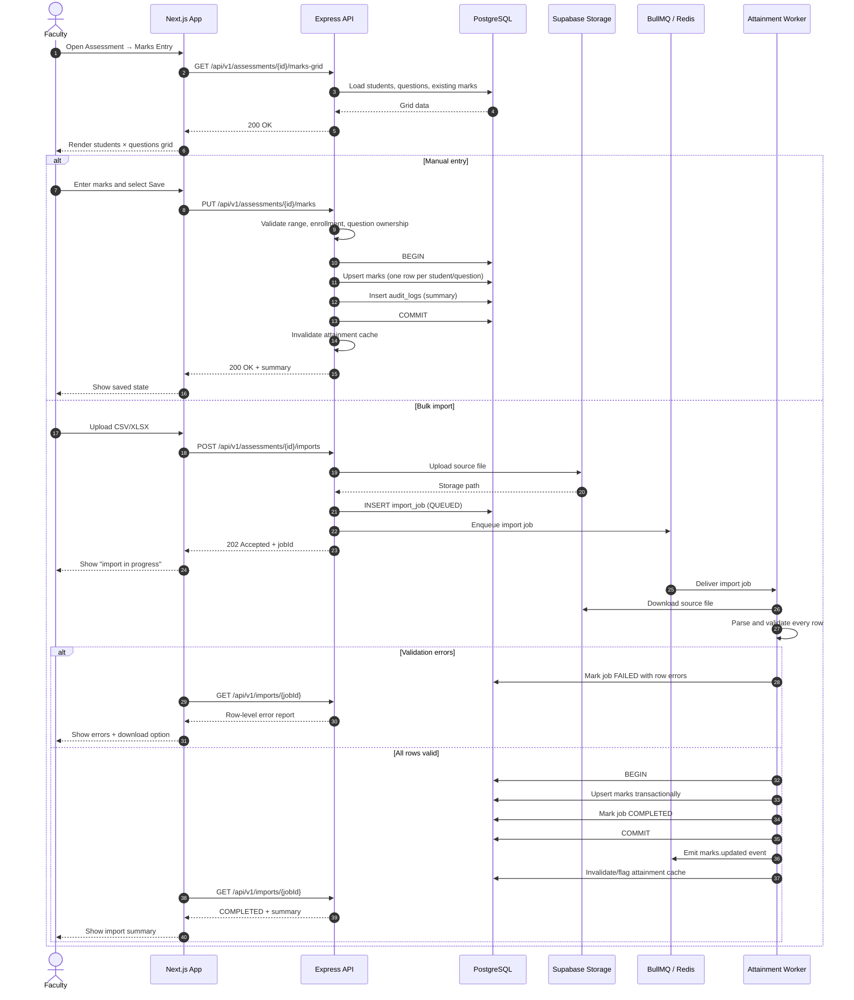
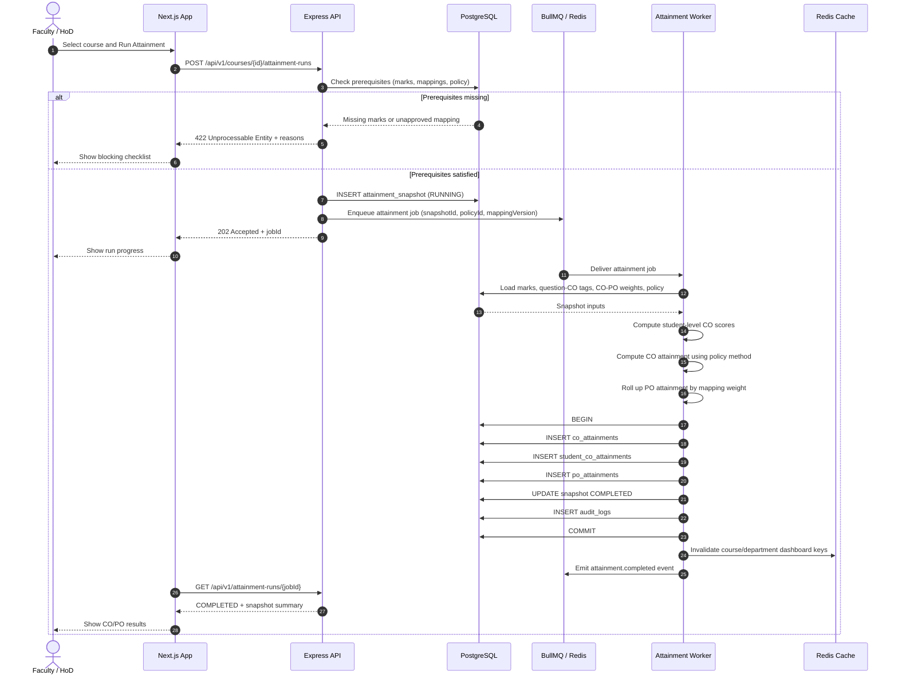
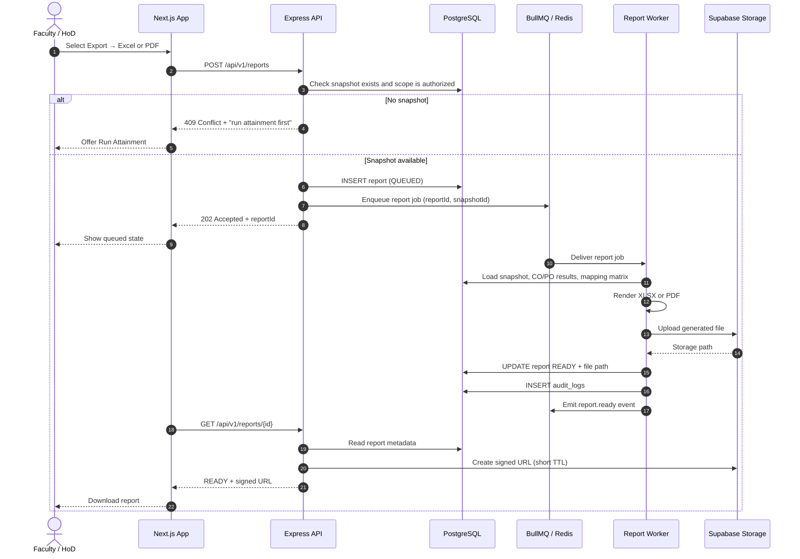
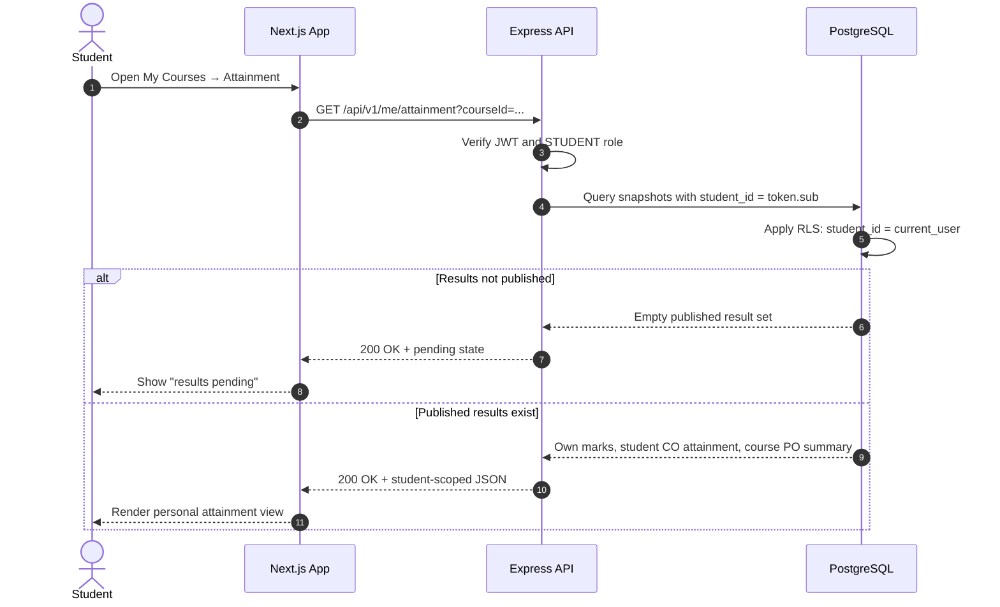
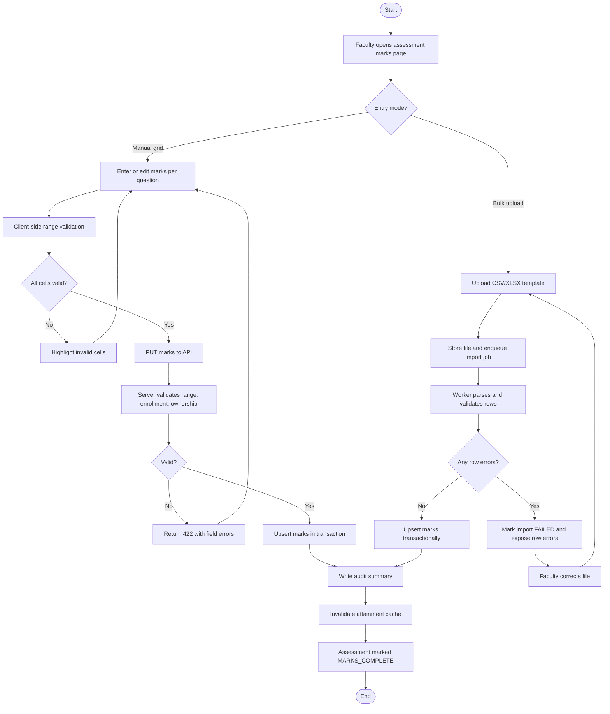
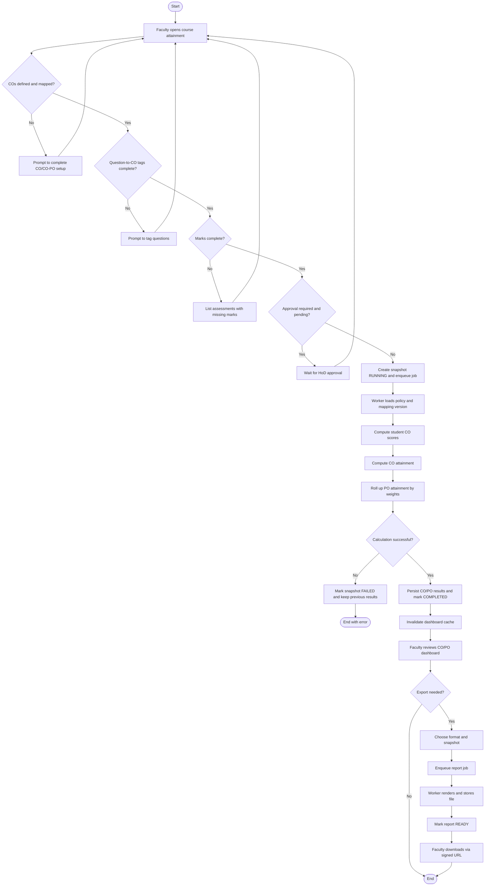
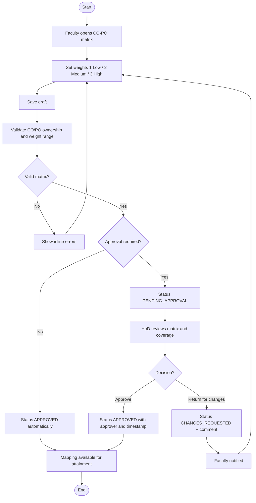

# OBE Management System — UML Sequence and Activity Modeling

**Session 7 Deliverable:** Sequence Diagrams and Activity Diagrams

This document models the dynamic behaviour of the OBE Management System. Sequence diagrams show **how objects collaborate over time**; activity diagrams show **the workflow and decision logic** behind the most important user journeys. The scenarios are drawn from the use cases in [EX5README.md](EX5README.md), the domain classes in [EX6README.md](EX6README.md), and the role workflow in [FLOW.md](FLOW.md).

## 1. Scope and Scenario Selection

The following scenarios carry the highest functional and architectural risk, so they are modelled in detail:

| ID | Scenario | Type | Primary use case |
|---|---|---|---|
| SD-01 | Login and role-based route/API authorization | Sequence | UC-01 |
| SD-02 | Define a course outcome | Sequence | UC-05 |
| SD-03 | Record marks manually or import them in bulk | Sequence | UC-11 |
| SD-04 | Calculate CO and PO attainment asynchronously | Sequence | UC-12, UC-13, UC-14 |
| SD-05 | Generate and download an attainment report | Sequence | UC-16 |
| SD-06 | Student views their own attainment | Sequence | UC-19 |
| AD-01 | Faculty marks-entry workflow | Activity | UC-11 |
| AD-02 | End-to-end attainment and reporting workflow | Activity | UC-12, UC-16 |
| AD-03 | CO-PO mapping approval workflow | Activity | UC-07, UC-08 |

## 2. Sequence Diagrams

### 2.1 SD-01 — Login and Role-Based Authorization

**Design notes**

- The JWT is never stored in `localStorage`; the HTTP-only cookie prevents token theft through XSS.
- Authorization is checked three times: middleware (page), API (route), and RLS (row). A failure at any layer is denied, not repaired.
- The API is stateless; it derives role and department from the token on every request.

### 2.2 SD-02 — Define a Course Outcome

**Design notes**

- The API re-validates every field; the frontend validation is only a usability shortcut.
- Course ownership is checked before the insert, so a faculty member cannot write to another faculty member's course.
- The insert and audit entry share one transaction, so an audited change cannot be lost.

### 2.3 SD-03 — Record Marks Manually or Import in Bulk

**Design notes**

- Manual saves are synchronous because the payload is small and the user expects immediate feedback.
- Bulk imports are asynchronous because file size and validation time are unbounded; the HTTP request only enqueues work.
- The import is all-or-nothing by default (BR-MARK-04) to prevent a partially updated grade book.
- `NULL` marks are preserved as absent; the worker never converts them to zero.

### 2.4 SD-04 — Calculate CO and PO Attainment

**Design notes**

- The snapshot is created before the job runs, giving the worker a stable ID and the UI a pollable resource.
- The job captures `policyId` and `mappingVersion`; if a mapping changes mid-run, the run still uses the captured inputs, preserving reproducibility.
- Results and the snapshot status update in one transaction. A failure leaves the snapshot `FAILED`, never half-populated.
- Cache invalidation happens only after commit, so readers never see stale results presented as fresh.

### 2.5 SD-05 — Generate and Download a Report

**Design notes**

- Report files are generated from a snapshot, never from live tables, so a downloaded report can always be reproduced.
- Signed URLs are short-lived; the object remains in storage under the retention policy.
- The report worker is separate from the attainment worker so a long PDF render does not delay attainment calculations.

### 2.6 SD-06 — Student Views Their Own Attainment

**Design notes**

- The query is scoped by the authenticated subject, not by a client-supplied student ID.
- RLS provides a second barrier if the API filter is ever bypassed.
- Students see published snapshots only; draft runs are invisible.

## 3. Activity Diagrams

### 3.1 AD-01 — Faculty Marks-Entry Workflow

### 3.2 AD-02 — End-to-End Attainment and Reporting Workflow

### 3.3 AD-03 — CO-PO Mapping Approval Workflow

## 4. Message and Interaction Design Rules

| Rule | Applies to | Rationale |
|---|---|---|
| All write endpoints validate with the shared Zod schema | SD-02, SD-03 | One contract for frontend and backend; no trust in client input |
| Every query is scoped by JWT claims or RLS | SD-01, SD-06 | Prevents horizontal privilege escalation |
| Synchronous only for small, bounded writes | SD-02, SD-03 manual | Keeps API latency within the 2 s read target |
| Asynchronous for imports, attainment, and reports | SD-03 bulk, SD-04, SD-05 | Work is unbounded and must not block HTTP workers |
| Jobs are idempotent and de-duplicated | SD-04, SD-05 | Retries must not create duplicate snapshots/reports |
| Status resources are pollable | SD-03, SD-04, SD-05 | Simple UI progress without a persistent websocket in v1 |
| Snapshot before compute | SD-04 | Reproducibility and safe rollback |
| Cache invalidation after commit | SD-03, SD-04 | Avoids serving stale attainment as current |
| Audit entry in the same transaction as the change | SD-02, SD-03, SD-04 | No unaudited state change |

### 4.1 Indicative API surface

| Method | Endpoint | Used by |
|---|---|---|
| `POST` | `/api/v1/auth/callback` | SD-01 (session exchange) |
| `GET` | `/api/v1/courses/:id/outcomes` | SD-02 |
| `POST` | `/api/v1/courses/:id/outcomes` | SD-02 |
| `GET` | `/api/v1/assessments/:id/marks-grid` | SD-03 |
| `PUT` | `/api/v1/assessments/:id/marks` | SD-03 manual |
| `POST` | `/api/v1/assessments/:id/imports` | SD-03 bulk |
| `GET` | `/api/v1/imports/:jobId` | SD-03 polling |
| `POST` | `/api/v1/courses/:id/attainment-runs` | SD-04 |
| `GET` | `/api/v1/attainment-runs/:jobId` | SD-04 polling |
| `POST` | `/api/v1/reports` | SD-05 |
| `GET` | `/api/v1/reports/:id` | SD-05 polling |
| `GET` | `/api/v1/me/attainment` | SD-06 |

## 5. Error and Compensation Behaviour

| Failure | Sequence | Behaviour |
|---|---|---|
| JWT expired | SD-01 | `401`; client refreshes once, otherwise redirects to login |
| CO code duplicate | SD-02 | `409`; no partial write |
| Invalid mark | SD-03 | `422`; the whole save is rejected, nothing upserted |
| Import validation failure | SD-03 | Job `FAILED`; no marks committed; row errors downloadable |
| Missing attainment prerequisites | SD-04 | `422`; no snapshot created |
| Worker crash during attainment | SD-04 | Snapshot `FAILED`; previous snapshot remains the active result |
| Report render failure | SD-05 | Report `FAILED`; retryable without changing the snapshot |
| Student accesses another student's row | SD-06 | `403`/empty result; the attempt is audited |

## 6. Traceability

| Scenario | Use case | Domain classes | Key non-functional concern |
|---|---|---|---|
| SD-01 | UC-01 | `User`, `Role` | Security, RBAC |
| SD-02 | UC-05 | `Course`, `CourseOutcome` | Data integrity, auditability |
| SD-03 | UC-11 | `Assessment`, `Question`, `Mark`, `Enrollment` | Performance, validation, atomicity |
| SD-04 | UC-12, UC-13, UC-14 | `AttainmentSnapshot`, `COAttainment`, `POAttainment`, `AttainmentPolicy` | Reproducibility, performance |
| SD-05 | UC-16 | `Report`, `AttainmentSnapshot` | Asynchronous processing, storage |
| SD-06 | UC-19 | `Student`, `Enrollment`, `COAttainment` | Privacy, row-level security |
| AD-01 | UC-11 | `Assessment`, `Mark` | Workflow completeness |
| AD-02 | UC-12, UC-16 | Attainment and report classes | End-to-end consistency |
| AD-03 | UC-07, UC-08 | `COPOMapping` | Governance and separation of duties |

## 7. Assumptions

- v1 uses polling for job status rather than WebSockets; the endpoint contract is designed so a push mechanism can replace polling later.
- The worker and API share the same PostgreSQL database but have separate process lifecycles.
- Attainment runs are per course offering; department-level reporting aggregates completed snapshots rather than recalculating every course.
- A report download never mutates the snapshot; repeated exports of the same snapshot are byte-stable for the same renderer version.
