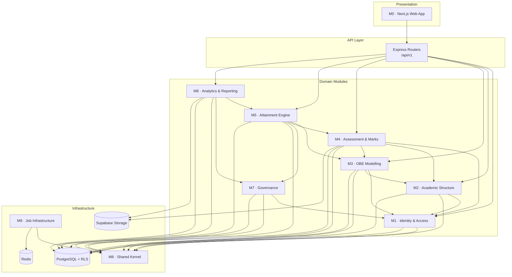

# OBE Management System — Software Design Principles Analysis

**Session 8 Deliverable:** Design Analysis Report

This report evaluates the design of the OBE Management System against established software design principles: modularization, coupling, cohesion, function-oriented versus object-oriented design, and top-down versus bottom-up decomposition. It uses the use case model from [EX5README.md](EX5README.md), the class model from [EX6README.md](EX6README.md), and the interaction model from [EX7README.md](EX7README.md) as design inputs.

## 1. Purpose

The goal is not to describe what the system does, but to judge **how well the design is structured to change**. The report answers:

- Is the system decomposed into modules with clear responsibilities?
- Are modules internally cohesive and externally loosely coupled?
- Is object-oriented design justified for the domain, and where is a function-oriented style better?
- Should the team design top-down, bottom-up, or both?
- Which design smells exist, and what is the refactoring plan?

## 2. Design Inputs and Constraints

| Input | What it contributes |
|---|---|
| Use cases (Session 5) | Functional boundaries and actor responsibilities |
| Class model (Session 6) | Domain entities, invariants, and relationships |
| Sequence/activity models (Session 7) | Collaboration boundaries and transaction/job boundaries |
| SRS (Session 4) | Non-functional targets: 2 s reads, async bulk work, RBAC, auditability |
| v1 roadmap | Single department, local deployment, 20-day delivery window |
| v3 target | Multi-tenant, cloud, CI/CD, observability, audit trail |

The v1 constraint is important: the design must be **modular enough to evolve to v3**, but not so distributed that a small team cannot deliver it. This pushes the design toward a **modular monolith** with explicit module boundaries, not microservices from day one.

## 3. Modularization Strategy

### 3.1 Module Decomposition

| ID | Module | Responsibility | Key classes / artifacts | Public interface |
|---|---|---|---|---|
| M0 | Web Presentation | Role-aware pages, forms, grids, dashboards | Next.js App Router pages, components, TanStack Query hooks | HTTP calls to `/api/v1`, shared Zod form schemas |
| M1 | Identity & Access | Authentication context, users, roles, department scoping | `User`, `Role`, auth middleware, RLS policies | `getAuthContext()`, `requireRole()`, `UserService` |
| M2 | Academic Structure | Departments, programs, courses, faculty allocation | `Department`, `Program`, `Course`, `Faculty` | `AcademicService` |
| M3 | OBE Modelling | COs, POs/PSOs, CO-PO matrix, approval state | `CourseOutcome`, `ProgramOutcome`, `COPOMapping` | `OutcomeService`, `MappingService` |
| M4 | Assessment & Marks | Assessments, questions, question-CO tags, marks, imports | `Assessment`, `Question`, `QuestionCOMapping`, `Mark`, `Enrollment` | `AssessmentService`, `MarksService`, `ImportService` |
| M5 | Attainment Engine | CO calculation, PO roll-up, snapshots, policy application | `AttainmentSnapshot`, `COAttainment`, `POAttainment`, `AttainmentPolicy` | `AttainmentService`, `AttainmentStrategy` |
| M6 | Analytics & Reporting | Dashboards, read models, exports, signed URLs | `Report`, read-model queries, exporter classes | `AnalyticsService`, `ReportService` |
| M7 | Governance | Audit trail and domain-event notifications | `AuditLog`, event subscribers | `AuditService`, `NotificationService` |
| M8 | Shared Kernel | Cross-cutting types, Zod schemas, error taxonomy, config | Shared package | Types, schemas, `AppError`, config loader |
| M9 | Job Infrastructure | Queue connection, worker bootstrap, retry policy | BullMQ setup, job contracts | `enqueue()`, job processors |

### 3.2 Module Dependency Diagram



### 3.3 Dependency Rules

1. **Downward dependencies only.** Presentation depends on API; API depends on domain services; domain services depend on the shared kernel and repository ports. No domain module imports from the web app.
2. **No cross-module table access.** M5 reads marks through M4's public read contract, not by querying M4's tables directly. M6 reads completed snapshots through M5's contract.
3. **No cycles.** If M5 needs CO data, it depends on M3's interface; M3 must not depend on M5. Events are used where a reverse notification is needed.
4. **Public surface per module.** Each module exposes an `index.ts` with services, DTOs, and events. Internal repositories and Prisma models stay private.
5. **Shared kernel has no business rules.** M8 may contain types, schemas, errors, and constants, but not attainment formulas or authorization decisions.
6. **Infrastructure is replaceable.** Prisma, Redis, and Supabase Storage sit behind ports so the domain does not depend on vendor SDKs.

## 4. Cohesion Analysis

Cohesion is judged from the weakest to the strongest form. The target is **functional cohesion** for domain services and **sequential cohesion** where a workflow naturally chains steps.

| Module | Dominant cohesion | Evidence | Assessment | Improvement |
|---|---|---|---|---|
| M1 Identity & Access | Functional | All operations serve one purpose: establish and enforce identity | Strong | Keep token verification and user administration as separate sub-services |
| M2 Academic Structure | Communicational | Department, program, and course operations work on a related data cluster | Acceptable | Split `AcademicService` into `DepartmentService`, `ProgramService`, `CourseService` if it grows |
| M3 OBE Modelling | Functional at submodule level | CO definition, PO definition, and mapping each have one reason to change | Strong | Keep mapping/approval in `MappingService`; do not merge with CO CRUD |
| M4 Assessment & Marks | Sequential / communicational | Assessment authoring → question tagging → marks entry → import forms a chain | Acceptable | Split authoring (`AssessmentService`) from marks ingestion (`MarksService`, `ImportService`) |
| M5 Attainment Engine | Functional | One purpose: turn evidence into attainment snapshots | Strong | Extract policy strategies; keep orchestration separate from pure math |
| M6 Analytics & Reporting | Communicational | Dashboards and exports both consume attainment snapshots | Moderate | Separate read-model queries from file rendering/generation |
| M7 Governance | Logical risk | Audit logging and notifications are different concerns | Weak if combined | Split `AuditService` and `NotificationService`; connect through events |
| M8 Shared Kernel | Coincidental risk | A shared package can become a dumping ground | Weak if unmanaged | Enforce folder ownership: `types/`, `validation/`, `errors/`, `config/`; no utility grab bag |
| M9 Job Infrastructure | Functional | Queue setup and worker lifecycle serve one purpose | Strong | Use one processor per job type; do not branch on job type inside a mega-processor |

### 4.1 Cohesion verdict

- **Strong:** M1, M3, M5, M9.
- **Acceptable with guardrails:** M2, M4, M6.
- **Needs deliberate structure:** M7, M8.

The main cohesion risk is not the domain logic; it is the **shared kernel and governance module** becoming catch-alls. These are addressed in the refactoring plan in Section 9.

## 5. Coupling Analysis

### 5.1 Coupling scale used

| Level | Name | Meaning | Desired? |
|---|---|---|---|
| 1 | Data | Modules exchange only needed data | **Target** |
| 2 | Stamp | Modules exchange whole structures when only part is needed | Tolerated at boundaries |
| 3 | Control | One module passes flags that steer another's internal logic | Avoid in domain |
| 4 | Common | Modules share global mutable state | Avoid |
| 5 | Content | One module reaches into another's internals | Prohibited |

### 5.2 Module-pair analysis

| Pair | Current/planned coupling | Evidence | Risk | Mitigation |
|---|---|---|---|---|
| Web → API | Data | JSON DTOs over REST | Low | Shared Zod schemas keep contracts aligned |
| API → Domain services | Data | Command/query DTOs, no Express types in services | Low | Controllers map HTTP to domain input |
| M4 → M3 | Data | Marks need CO IDs and question-CO tags | Low–medium | Read-only `OutcomeReader` port; never import M3 entities into M4 tables |
| M5 → M4 | Data / stamp risk | Attainment needs marks and question tags | Medium | Pass `{ studentId, questionId, marks, coId }` projections, not full entities |
| M5 → M3 | Stamp risk | Attainment needs weights and CO-PO mappings | Medium | Dedicated `AttainmentInputReader` returning minimal projections |
| M6 → M5 | Data | Reporting reads snapshot by ID | Low | Snapshot is an immutable, explicit contract |
| M7 → Domain | Data (events) | Audit/notifications subscribe to domain events | Low | Events carry IDs and minimal payloads, not ORM objects |
| Domain → M8 | Common risk | Shared config/client imports | Medium | Read-only config object; no mutable globals |
| Domain → Prisma | Content risk if raw models leak | Repositories return domain DTOs | High if ignored | Repository pattern + mapping layer |
| Worker → Domain | Data | Job payloads carry IDs and versions | Low | Never serialize full entities into Redis |

### 5.3 Control-coupling hotspots and fixes

| Hotspot | Why it is control coupling | Refactor |
|---|---|---|
| `calculate(courseId, mode)` | The mode flag steers internal branches | Replace with `AttainmentStrategy` implementations |
| `exportReport(format)` switch | Caller decides internal rendering branch | Use an `ExporterFactory` returning `ReportExporter` |
| `importFile(type)` branching | Job processor chooses parser by type | One job type per parser; or a parser registry |
| `getDashboard(role)` | Role flag changes query shape inside one function | Separate role-scoped queries or compose read-model policies |

### 5.4 Coupling verdict

The planned design is predominantly **data-coupled** at module boundaries, which is appropriate. The two areas that can silently degrade are:

1. **Prisma model leakage** — if services accept or return Prisma types, every schema change ripples through the domain.
2. **Shared mutable state** — a global Prisma client is acceptable, but a global cache or request context must be passed explicitly.

Both are preventable with repository ports and request-scoped context.

## 6. Function-Oriented versus Object-Oriented Design

### 6.1 Comparison for this system

| Criterion | Function-oriented | Object-oriented | Choice for OBE |
|---|---|---|---|
| Attainment math | Pure functions are easy to test and reason about | Requires object setup for simple formulas | **Function-oriented kernel**, OO orchestration |
| Domain invariants | Scattered validation | Encapsulated in entities/services | **OO** |
| Extensibility of calculation policy | `if/else` or function pointers | Polymorphic strategies | **OO (Strategy)** |
| Export formats | A function per format is simple | Factory + polymorphic exporters | **OO factory, functional renderers** |
| React UI | Functional components are idiomatic | Class components are legacy | **Function-oriented** |
| Batch data processing | Pipelines compose naturally | Objects add ceremony | **Function-oriented** |
| Long-lived state (snapshots, approvals) | Harder to model | Natural fit | **OO** |

### 6.2 Chosen hybrid design

The system uses **object-oriented domain modelling with functional calculation kernels**:

- **OO for entities and services:** `CourseOutcome`, `COPOMapping`, `AttainmentSnapshot`, and their services own invariants and lifecycle transitions.
- **Functional for pure calculations:** CO score aggregation, threshold classification, and weighted PO roll-up are pure functions with explicit inputs and outputs. They are deterministic and easy to property-test.
- **Functional for UI:** Next.js server/client components are functions; state is managed through hooks and TanStack Query.
- **OO for variability:** `AttainmentStrategy` and `ReportExporter` use polymorphism so new policies/formats do not modify existing code.

```ts
interface AttainmentStrategy {
  calculate(input: AttainmentInput): CoAttainmentResult[];
}

class ThresholdAttainmentStrategy implements AttainmentStrategy {
  calculate(input: AttainmentInput): CoAttainmentResult[] {
    // percentage of students at or above the policy threshold
  }
}

class AverageAttainmentStrategy implements AttainmentStrategy {
  calculate(input: AttainmentInput): CoAttainmentResult[] {
    // average normalized score per CO
  }
}
```

### 6.3 Why not pure function-oriented?

A purely function-oriented design would push policy and state handling into long parameter lists and conditionals. The CO-PO approval state machine, snapshot immutability, and role-scoped services are naturally object-oriented. Conversely, a purely OO design would wrap every formula in a class and make the attainment kernel harder to test.

### 6.4 Why not pure object-oriented?

The calculation kernel does not need identity or mutable state. Making it a set of pure functions gives faster tests, simpler reasoning, and easier reuse by both the API and the worker. This is a deliberate **functional core, imperative shell** choice.

## 7. Top-Down versus Bottom-Up Design

### 7.1 Comparison

| Approach | Strengths | Weaknesses | Fit for OBE |
|---|---|---|---|
| Top-down | Clear architecture, stable interfaces, early integration planning | Risk of over-design; details may not fit | Good for layers, modules, API contracts, use cases |
| Bottom-up | Early proof of difficult parts, reusable primitives | Integration surprises; architecture may emerge accidentally | Good for calculation kernel, schemas, data fixtures |
| Hybrid | Contracts first, then vertical slices | Requires discipline to keep contracts current | **Chosen approach** |

### 7.2 Applied hybrid plan

| Phase | Approach | Activities | Output |
|---|---|---|---|
| 1. Frame | Top-down | Confirm use cases, module boundaries, API versioning, role model | Module map, endpoint list |
| 2. Contract | Top-down + bottom-up | Write shared Zod schemas and domain types; validate against real data samples | `packages/shared` contracts |
| 3. Risk spikes | Bottom-up | Build the attainment kernel and test it with synthetic marks; validate CO-PO math | Tested calculation functions |
| 4. Vertical slices | Both | Implement one use case end to end (e.g. CO definition), then marks, then attainment | Working slices with tests |
| 5. Integrate | Top-down | Wire workers, reports, dashboards; verify NFRs | v1 release candidate |
| 6. Harden | Bottom-up | Fill edge cases, performance tests, security tests, audit coverage | v2-ready baseline |

### 7.3 Why this order

- **Top-down prevents accidental architecture.** The team agrees on modules and contracts before writing features.
- **Bottom-up de-risks the hardest logic.** The attainment engine is the core differentiator; it must be proven early with real marks, threshold rules, and CO-PO weights.
- **Vertical slices prevent integration debt.** Each slice crosses UI → API → domain → database, so boundary problems surface in days, not at the end.

## 8. SOLID and GRASP Application

### 8.1 SOLID

| Principle | Application | Example |
|---|---|---|
| **S**ingle Responsibility | One reason to change per service | `OutcomeService` does not render reports; `ReportService` does not compute attainment |
| **O**pen/Closed | Add behaviour by adding classes, not editing conditionals | New attainment method = new `AttainmentStrategy`; new export = new `ReportExporter` |
| **L**iskov Substitution | Implementations honour the same contract | Any `ReportExporter` can replace another without changing the caller |
| **I**nterface Segregation | Narrow read/write ports | `AttainmentReader`, `AttainmentWriter`, `AuditWriter` instead of one fat repository |
| **D**ependency Inversion | Domain depends on abstractions | `AttainmentService` depends on `MarksReader`/`MappingReader`, not Prisma |

### 8.2 GRASP

| Pattern | Where applied |
|---|---|
| **Controller** | Express routers translate HTTP to service calls |
| **Creator** | `Course` creates `CourseOutcome`; `Assessment` creates `Question` |
| **Information Expert** | `AttainmentSnapshot` owns its CO/PO result accessors; `COPOMapping` knows its weight |
| **Low Coupling** | Module public interfaces, events, DTOs |
| **High Cohesion** | One service per responsibility (M3, M5) |
| **Polymorphism** | Attainment strategies and report exporters |
| **Pure Fabrication** | Repository and read-model classes that do not exist in the domain |
| **Indirection** | Queue between API and worker; storage adapter between domain and Supabase |
| **Protected Variations** | Strategy/Factory isolate changes in policy and export format |

## 9. Design Smells and Refactoring Plan

| ID | Smell | Where | Impact | Refactoring | Priority |
|---|---|---|---|---|---|
| DS-01 | Shared kernel becomes a dumping ground | M8 | Hidden coupling, slow builds | Enforce subfolders and ownership; no business logic; review imports | High |
| DS-02 | Governance module mixes audit and notifications | M7 | Logical cohesion, two reasons to change | Split `AuditService` and `NotificationService`; connect via events | High |
| DS-03 | Prisma models leak into services | Data layer | Schema changes ripple everywhere | Repository ports + domain DTO mapping | High |
| DS-04 | Fat `AttainmentService` | M5 | Hard to test, merge conflicts | Separate orchestration, input loading, pure calculation, persistence | High |
| DS-05 | Role flag branching in services | M1/M6 | Control coupling | Capability checks and role-scoped query objects | Medium |
| DS-06 | Async job payloads carry entities | M9 | Serialization drift, stale data | Pass IDs + version + minimal snapshot metadata | Medium |
| DS-07 | Duplicate validation in UI and API | Web/API | Inconsistent rules | Shared Zod schemas; server remains authoritative | Medium |
| DS-08 | Cross-module SQL joins in reporting | M6 | Coupling to other modules' tables | Reporting read models built from published snapshots | Medium |
| DS-09 | Inheritance-heavy user model | M1 | Fragile role additions | Role enum + capability map; compose profiles if needed | Low |
| DS-10 | Polling everywhere | Web | Wasted requests | Keep polling contract but add backoff; consider SSE in v2 | Low |

## 10. Design Evaluation Summary

| Quality | Rating | Reason |
|---|---|---|
| Modularity | Good | Clear domain modules with published interfaces and one-way dependencies |
| Cohesion | Good with two risks | Core domain is functional; shared kernel and governance need discipline |
| Coupling | Good | Mostly data coupling; Prisma leakage and shared state are the main threats |
| Extensibility | Good | Strategy/Factory cover the two most likely change axes: policy and export format |
| Testability | Strong | Pure calculation kernel + service orchestration + repository ports |
| v3 readiness | Moderate | Modular monolith can be split later; multi-tenancy and observability are designed in, not retrofitted |

**Conclusion:** The OBE Management System is designed as a modular monolith with a functional calculation core and object-oriented domain services. The design satisfies high cohesion and low coupling at the module level, with deliberate guardrails around the shared kernel and Prisma access. The hybrid top-down/bottom-up process matches the 20-day v1 constraint while preserving a credible path to the v3 multi-tenant architecture.

## 11. Traceability

| Design principle | Evidence in this document | Related sessions |
|---|---|---|
| Modularization | Section 3 module map and dependency rules | Session 5, Session 9 |
| Coupling | Section 5 module-pair and control-coupling analysis | Session 5, Session 7 |
| Cohesion | Section 4 module ratings | Session 6 |
| Function vs object orientation | Section 6 hybrid decision | Session 6, Session 9 |
| Top-down vs bottom-up | Section 7 phased plan | All sessions |
| SOLID/GRASP | Section 8 principle mapping | Session 9 |
| Refactoring | Section 9 prioritized plan | Session 10 (future metrics) |
