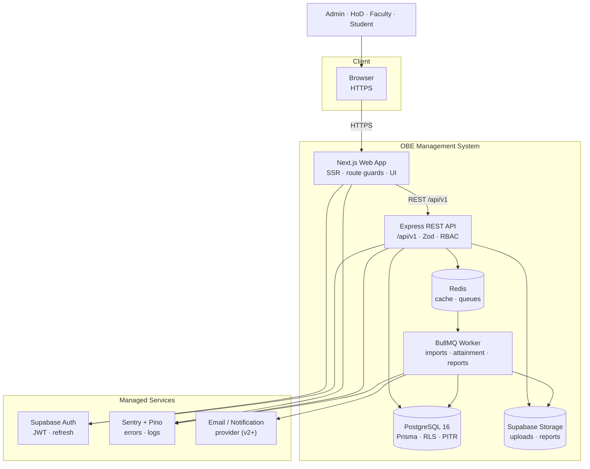
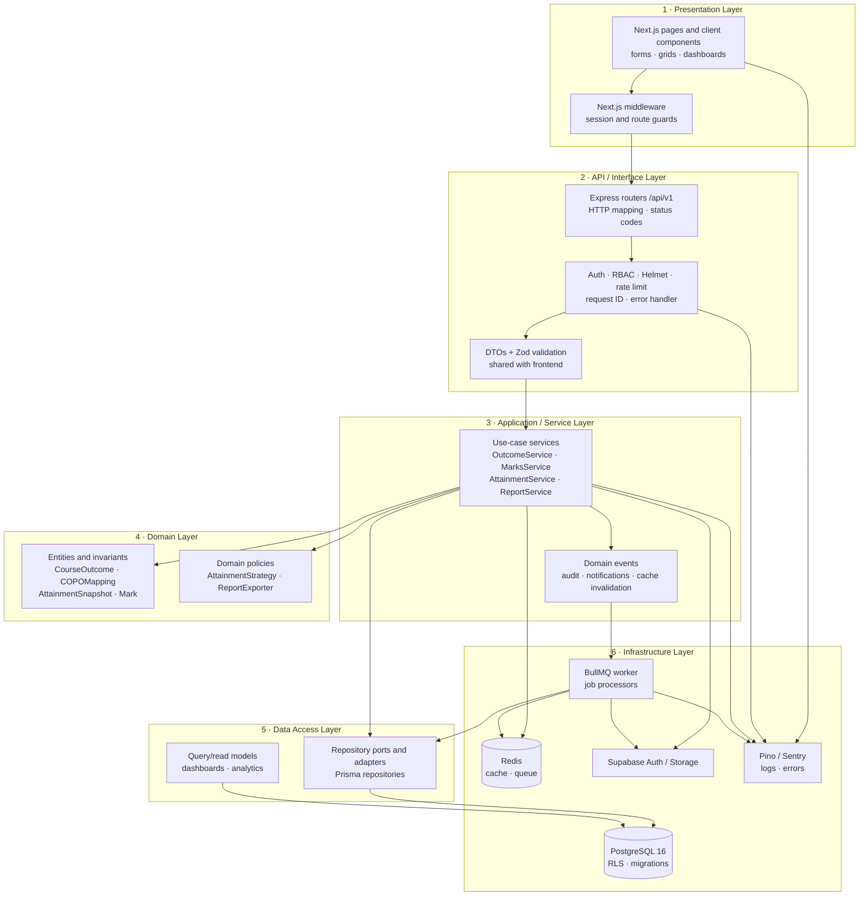
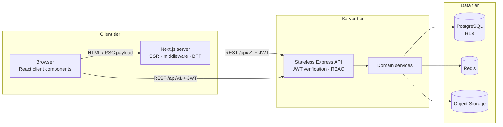
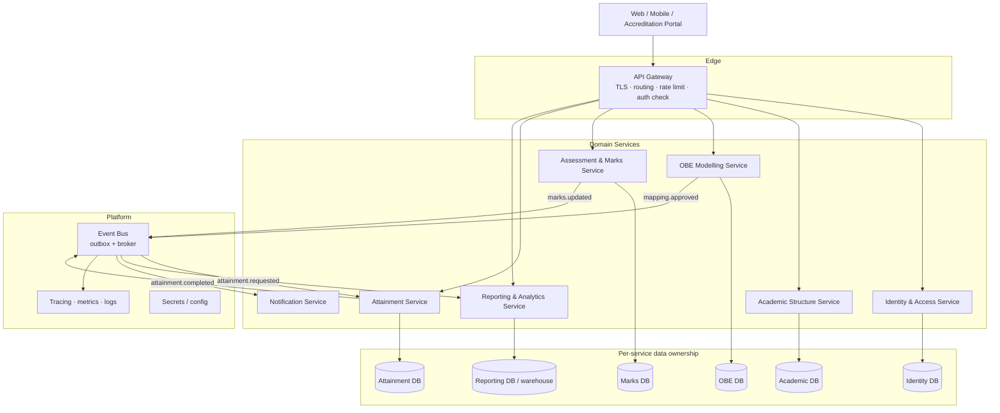

# OBE Management System — Software Architecture and Design Patterns

**Session 9 Deliverable:** System Architecture Diagram, Layered Architecture, Client-Server and Microservices Views, and Design Pattern Catalogue

This document defines the software architecture of the OBE Management System. It builds on the design principles analysis in [EX8README.md](EX8README.md), the class model in [EX6README.md](EX6README.md), and the dynamic behaviour in [EX7README.md](EX7README.md). The v1 target is a **modular monolith** deployed locally; the v3 target is a **multi-tenant, cloud-hosted, service-oriented architecture**.

## 1. Architecture Goals and Drivers

| Driver | Requirement | Architectural response |
|---|---|---|
| Correctness of attainment | CO/PO results must be reproducible and auditable | Immutable snapshots, explicit policy/mapping versions, transactional writes |
| Security and privacy | Admin, HoD, Faculty, and Student see only permitted data | JWT claims + API authorization + PostgreSQL RLS |
| Responsiveness | Standard reads under 2 s; heavy work must not block | Precomputed snapshots, Redis cache, asynchronous BullMQ jobs |
| Scalability | Grow from one department to a college-wide multi-tenant system | Stateless API, horizontal replicas, tenant-scoped data model, service extraction path |
| Maintainability | Small team, 20-day v1, long-term v3 | Modular monolith with strict module boundaries and shared contracts |
| Operability | Detect failures and deploy safely | Structured logs, Sentry, health checks, CI/CD, migrations, backups |
| Accreditation evidence | Reports must be defensible | Audit log, versioned snapshots, signed report files with retention |

## 2. System Context



**Context notes**

- The browser never talks to PostgreSQL or Redis directly.
- Supabase Auth is the only credential verifier; the API verifies the resulting JWT and trusts only its signed claims.
- Redis plays two roles: a cache for read models and the BullMQ broker for background jobs.
- The worker shares the database but not the request lifecycle; it is the only place where long-running work executes.

## 3. Layered Architecture



### 3.1 Layer responsibilities

| Layer | Owns | Must not do | Dependency rule |
|---|---|---|---|
| **Presentation** | Rendering, route guards, client-side form feedback, TanStack Query state | Business rules, direct database access | Depends on HTTP API only |
| **API / Interface** | HTTP contracts, auth middleware, validation, status/error mapping | Calculation logic, Prisma queries | Depends on application services |
| **Application / Service** | Use-case orchestration, transactions, job enqueueing, authorization decisions | SQL, Express `req`/`res`, UI concerns | Depends on domain + repository ports |
| **Domain** | Invariants, state transitions, calculation policies | Framework code, I/O, logging infrastructure | Depends on nothing external |
| **Data Access** | Persistence mapping, queries, read models | Business decisions, HTTP concerns | Implements ports used by services |
| **Infrastructure** | PostgreSQL, Redis, Supabase, workers, observability | Domain rules | Pluggable behind adapters |

### 3.2 Layer interaction example

A marks save flows strictly downward:

`MarksGrid (L1) → PUT /marks (L2) → Zod + RBAC (L2) → MarksService (L3) → Mark/CourseOutcome invariants (L4) → MarkRepository (L5) → PostgreSQL (L6)`

No layer reaches upward. The worker uses the same L3–L5 services, which is why the calculation never forks into a second implementation.

## 4. Client-Server Architecture

The system uses a **thin client, authoritative server** model with a REST boundary.



| Concern | Decision | Rationale |
|---|---|---|
| Rendering | Next.js Server Components for pages; client components for interactive grids/matrices | Fast first load plus rich interaction where needed |
| API style | REST under `/api/v1` | Simple, cacheable, well understood by the team; versioned for evolution |
| API state | Stateless; JWT on every request | Horizontal scaling; no sticky sessions |
| Auth boundary | Supabase Auth issues tokens; Express verifies them | One identity provider; no custom password storage |
| Session storage | HTTP-only cookie at the web layer; Bearer token on API calls | Mitigates XSS token theft |
| Data fetching | TanStack Query on the client; server-side fetch for initial pages | Caching, retries, and optimistic UI without a global store |
| File transfer | Direct signed URLs for downloads; uploads proxied through API | Keeps storage credentials server-side |
| API evolution | Version prefix `/api/v1`; additive changes; deprecation policy | Avoid breaking deployed clients |
| Caching | Redis for dashboards/matrices; HTTP cache headers for static assets | Meets read-latency target without stale writes |
| Failure model | Bounded retries with backoff; idempotent job IDs | Safe recovery from transient failures |

### 4.1 Why the Next.js server acts as a BFF

The Next.js server component layer performs three jobs that should not run in the browser:

1. Reads the HTTP-only session cookie and injects the bearer token for API calls.
2. Applies route-level role guards before rendering.
3. Shapes server responses into page-specific view models.

This is a **Backend-for-Frontend** pattern at small scale. In v3, if multiple clients (mobile, external accreditation portal) appear, a dedicated API gateway/BFF can be introduced without changing the domain API.

## 5. Microservices — Conceptual Architecture (v3)

Microservices are **not** the v1 deployment model. v1 is a modular monolith. The purpose of this section is to show a credible, low-risk decomposition path if scale, team size, or release cadence demand it.

### 5.1 Service decomposition



### 5.2 Service boundaries and data ownership

| Service | Owns | Publishes | Consumes |
|---|---|---|---|
| Identity & Access | Users, roles, department claims | `user.updated`, `role.changed` | — |
| Academic Structure | Departments, programs, courses, enrollment | `course.updated`, `enrollment.changed` | `user.updated` |
| OBE Modelling | COs, POs, CO-PO mappings, approvals | `mapping.approved`, `outcome.updated` | `course.updated` |
| Assessment & Marks | Assessments, questions, tags, marks, imports | `marks.updated`, `import.completed` | `outcome.updated`, `enrollment.changed` |
| Attainment | Policies, snapshots, CO/PO results | `attainment.completed`, `attainment.failed` | `marks.updated`, `mapping.approved` |
| Reporting & Analytics | Report metadata, read models, generated files | `report.ready` | `attainment.completed` |
| Notification | Delivery preferences and outbox | `notification.sent` | `attainment.completed`, `report.ready`, `mapping.changed` |

**Rule:** each service owns its database. No cross-service SQL joins. Cross-service reads use APIs or event-fed read models.

### 5.3 Synchronous vs asynchronous interactions

| Interaction | Style | Why |
|---|---|---|
| Browser → gateway → service | Synchronous REST | User needs an immediate response |
| Marks update → attainment | Asynchronous event/job | Calculation is expensive and retryable |
| Attainment completion → report | Asynchronous event/job | Rendering can be slow and must not block |
| Mapping approval → notification | Asynchronous event | Best-effort delivery; user does not wait |
| Reporting dashboard → snapshot store | Synchronous read of a completed snapshot | Snapshot is immutable and fast |

### 5.4 When to extract a service

A module should become a service only when at least two of these are true:

1. It needs independent scaling (e.g. marks imports at peak result time).
2. A separate team wants an independent release cadence.
3. Its failure domain must not take down the rest of the system.
4. It has a genuinely independent data ownership boundary.
5. Its load profile is fundamentally different (CPU-heavy report rendering vs CRUD).

For v1, none of these justify distributed transactions. The attainment engine and report worker are **processes**, not services, and share the monolith's database.

### 5.5 Migration path from the modular monolith

| Stage | Change | Risk control |
|---|---|---|
| v1 | Modular monolith + worker processes | Strict module interfaces, no cross-module table access |
| v2 | Extract Reporting and Notification services | Outbox events; reporting reads snapshots, not live tables |
| v2.5 | Extract Attainment as a worker service | Idempotent jobs, explicit input contract, versioned policies |
| v3 | Split Marks and OBE services if scale requires | API gateway, distributed tracing, per-service databases, sagas for cross-service workflows |
| v3+ | Multi-tenant isolation | Tenant claims propagated in tokens/events; per-tenant rate limits and quotas |

## 6. Design Pattern Catalogue

### 6.1 Structural and architectural patterns

| Pattern | Problem it solves | Application in OBE | Benefits | Trade-offs |
|---|---|---|---|---|
| **Layered Architecture** | Mixing UI, business rules, and persistence | Six layers from presentation to infrastructure | Clear responsibilities; testable domain | Pass-through layers if boundaries are not enforced |
| **Modular Monolith** | Microservices would be too costly for a small team | Module boundaries M0–M9 inside one deployable API | Simple operations; strong transactions; future extraction path | Requires discipline to prevent a big ball of mud |
| **Client-Server** | Shared UI logic and data access | Next.js client/server + REST API + database | Central authorization and data integrity | Network latency; API contract maintenance |
| **BFF (Backend-for-Frontend)** | Browser needs role-aware, page-shaped data | Next.js server components read cookies and call the API | Smaller payloads; secrets stay server-side | Extra server hop; duplicated view logic if not careful |
| **API Gateway** (v3) | Many clients and services | Edge routing, TLS, rate limits, auth check | Central policy and observability | Another hop and component to operate |
| **CQRS-lite** | Read dashboards and write workflows have different shapes | Write services normalized; reporting read models optimized for dashboards | Fast reads; simpler queries | Eventual consistency; projection maintenance |

### 6.2 Application and domain patterns

| Pattern | Problem it solves | Application in OBE | Benefits | Trade-offs |
|---|---|---|---|---|
| **MVC** | Separate request handling, domain logic, and response | Express router = controller; service = model logic; DTO = view | Familiar, clean HTTP boundary | Controllers can become fat if validation leaks |
| **Service Layer** | Use cases span multiple entities and repositories | `OutcomeService`, `MarksService`, `AttainmentService`, `ReportService` | Transaction boundaries, reuse by API and worker | Fat services if responsibilities are not split |
| **Repository** | Domain should not depend on Prisma/SQL | `CourseRepository`, `MarkRepository`, `SnapshotRepository` ports + Prisma adapters | Testability; vendor isolation | Mapping overhead; leaky abstractions if over-generalized |
| **Unit of Work** | Several writes must commit or roll back together | Marks upsert + audit row; snapshot + results + status | Atomicity and consistent audit | Transaction scope must stay small |
| **DTO + Validator** | Untrusted input and cross-layer contracts | Shared Zod schemas in `packages/shared`; request/response DTOs | One contract; security; generated types | Mapping boilerplate; schema versioning |
| **Strategy** | Multiple attainment policies | `ThresholdAttainmentStrategy`, `AverageAttainmentStrategy` selected by `AttainmentPolicy.method` | Add policy without editing orchestrator; testable variants | More classes; selection logic must be centralized |
| **Factory Method** | Create the right exporter/parser without conditionals in callers | `ReportExporterFactory` returns `XlsxExporter` or `PdfExporter`; job processor registry | Open/Closed for new formats | Indirection; factory must stay in sync with supported types |
| **Adapter** | Domain should not depend on vendor SDKs | Supabase Auth adapter, Supabase Storage adapter, BullMQ queue adapter, ExcelJS wrapper | Replaceable vendors; mockable in tests | Extra interfaces; occasional lowest-common-denominator API |
| **Observer / Domain Events** | Decouple side effects from the main transaction | `marks.updated` → invalidate cache/audit; `attainment.completed` → notify/report | Loose coupling; extensible side effects | Eventual consistency; event schema evolution |
| **Singleton** | One shared connection/config/logger per process | Prisma client, Redis connection, Pino logger | Avoids duplicate connections | Hidden global state; test isolation |
| **Circuit Breaker + Retry** | Transient external failures | Supabase/email calls; job retries with exponential backoff | Resilience | Duplicate side effects unless operations are idempotent |
| **Idempotent Consumer** | Queue retries may deliver a job twice | `jobId`/`snapshotId` uniqueness; upsert semantics | Safe retries | Dedupe storage; careful transaction design |
| **Transactional Outbox** | Database change and event publication must both succeed | Write audit/status + outbox row in one transaction; publisher forwards to Redis | No lost events | Extra table/publisher; at-least-once delivery |
| **Bulkhead** | One workload starves another | Separate queues/worker concurrency for imports, attainment, reports | Failure isolation; predictable latency | More infra and tuning |
| **Saga (v3)** | Cross-service workflow with compensation | Attainment run across Marks/OBE/Attainment services | Handles distributed failure | Complexity; only justified after service extraction |

### 6.3 Pattern code sketches

**Strategy — attainment policy**

```ts
interface AttainmentStrategy {
  calculate(input: AttainmentInput): CoAttainmentResult[];
}

class ThresholdAttainmentStrategy implements AttainmentStrategy {
  calculate(input: AttainmentInput): CoAttainmentResult[] {
    // count students whose normalized CO score >= policy.thresholdPercent
  }
}

class AverageAttainmentStrategy implements AttainmentStrategy {
  calculate(input: AttainmentInput): CoAttainmentResult[] {
    // average normalized CO score across the cohort
  }
}
```

**Factory — report export**

```ts
interface ReportExporter {
  render(snapshot: AttainmentSnapshot): Promise<Buffer>;
}

class ReportExporterFactory {
  constructor(
    private readonly xlsx: ReportExporter,
    private readonly pdf: ReportExporter,
  ) {}

  create(format: ReportFormat): ReportExporter {
    switch (format) {
      case "XLSX":
        return this.xlsx;
      case "PDF":
        return this.pdf;
    }
  }
}
```

**Repository — persistence port**

```ts
interface MarkRepository {
  upsertMany(marks: MarkInput[]): Promise<void>;
  findByAssessment(assessmentId: string): Promise<Mark[]>;
  countMissing(assessmentId: string): Promise<number>;
}
```

The service depends on `MarkRepository`, not on `PrismaClient`. The Prisma implementation lives in the data-access layer.

## 7. How the Patterns Cooperate — Attainment Run Walkthrough

| Step | Action | Patterns involved |
|---|---|---|
| 1 | Faculty calls `POST /api/v1/courses/:id/attainment-runs` | MVC (controller), DTO + Validator |
| 2 | API verifies JWT, role, and course scope | Client-Server, layered security |
| 3 | `AttainmentService` checks prerequisites through repository ports | Service Layer, Repository, Dependency Inversion |
| 4 | Service creates a `RUNNING` snapshot and an outbox event in one transaction | Transactional Outbox, Unit of Work |
| 5 | Job is enqueued through a queue adapter | Adapter, Idempotent Consumer |
| 6 | Worker loads marks/mappings/policy projections | Repository, CQRS-lite read projections |
| 7 | Strategy selected from the policy; CO and PO calculations run | Strategy, functional core |
| 8 | Results persist and the snapshot becomes `COMPLETED` | Repository, transaction boundary |
| 9 | `attainment.completed` triggers cache invalidation, audit, and notification | Observer, Adapter |
| 10 | Faculty requests an export | Factory, Adapter, async job |
| 11 | Report worker renders and stores the file | Factory, Strategy-like exporter contract, Adapter |

This walkthrough demonstrates the main architectural rule: **the API orchestrates, the domain decides, the worker executes, and infrastructure is replaceable.**

## 8. Architecture Decision Records (Summary)

| ADR | Decision | Rationale | Consequences |
|---|---|---|---|
| ADR-01 | Modular monolith first, microservices later | Small team, 20-day v1, strong transactional consistency needed | Must enforce module boundaries; extraction path documented in Section 5.5 |
| ADR-02 | REST `/api/v1` rather than GraphQL | Simple, cacheable, easy authorization per endpoint | Over/under-fetching for dashboards is handled by read models |
| ADR-03 | Supabase for Auth, PostgreSQL, Storage | Managed operations, RLS, PITR, fast setup | Vendor coupling is isolated behind adapters |
| ADR-04 | Defense-in-depth authorization | Middleware + API + RLS | Slightly more configuration; much lower data-leak risk |
| ADR-05 | BullMQ + Redis for heavy work | Imports, attainment, and reports are unbounded | Requires idempotency, retries, queue monitoring |
| ADR-06 | Precomputed attainment snapshots | Fast dashboards and reproducible reports | Historical storage growth; snapshot lifecycle management |
| ADR-07 | Shared Zod contracts | One schema for UI and API | Contract changes require coordinated releases |
| ADR-08 | Next.js server components + client components | Fast initial load and rich interactive grids | Two rendering mental models; clear ownership rules needed |
| ADR-09 | Redis cache for read-heavy dashboards | Meets 2 s read target under load | Invalidation must be event-driven and tested |
| ADR-10 | Pino + Sentry + correlation IDs | Operability from day one | Log volume and PII scrubbing require policy |

## 9. Cross-Cutting Concerns

### 9.1 Security

- HTTPS everywhere; HSTS at the edge.
- Short-lived JWTs; HTTP-only cookies at the web tier; no tokens in `localStorage`.
- Helmet, CORS allow-list, rate limiting on auth and write endpoints.
- Zod validation on every request; no ORM object accepted from the client.
- RLS session context set per transaction; tests verify cross-tenant denial.
- Signed, expiring URLs for report downloads; storage buckets are private.
- Audit log is append-only and excludes secrets/tokens.

### 9.2 Multi-tenancy path

| Version | Isolation |
|---|---|
| v1 | Single department; roles scoped by course assignment |
| v2 | College → department → program; RLS policies use department claims |
| v3 | Tenant (college) ID in JWT and every row; per-tenant rate limits, storage prefixes, and optional dedicated databases for large tenants |

### 9.3 Observability

| Signal | Tool | What is captured |
|---|---|---|
| Structured logs | Pino | Request ID, user ID, role, route, latency, error code; no PII payloads |
| Errors | Sentry | Stack traces, release version, request correlation |
| Metrics | Platform metrics + app counters | Request rate/latency/errors, queue depth, job duration, cache hit rate |
| Health | `/api/v1/health` | Process liveness and dependency readiness |
| Audit | `audit_logs` | Data-changing actions, actor, before/after, timestamp |

### 9.4 Performance and availability

- Indexes on `(course_id, code)`, `(student_id, question_id)`, `(snapshot_id)`, `(entity_type, entity_id, timestamp)`.
- Dashboard reads served from snapshots/cache, never from live aggregation of marks.
- API replicas are stateless; workers scale independently by queue.
- Retries with exponential backoff and dead-letter handling for jobs.
- Supabase PITR plus scheduled `pg_dump` snapshots to object storage.
- Graceful degradation: if Redis is unavailable, reads fall back to PostgreSQL; writes that require a queue return `503` with a retry hint rather than silently dropping work.

### 9.5 CI/CD and environments

| Stage | Checks |
|---|---|
| Pull request | Lint, typecheck, Vitest, Prisma schema validation, build |
| Merge to `main` | Migrations (staging first), deploy API/web, run smoke tests |
| Production | Blue/green or rolling deploy, health checks, automatic rollback on failed health |
| Post-deploy | Sentry release tagging, queue depth check, attainment smoke test on a seed course |

## 10. Architectural Risks and Mitigations

| Risk | Impact | Mitigation |
|---|---|---|
| Module boundaries erode into a monolith ball of mud | Hard to extract services later | Import rules, code review checklist, per-module `index.ts` |
| Long report renders starve attainment jobs | Delayed results | Separate queues/workers (bulkhead) |
| Cache invalidation misses | Stale dashboards | Event-driven invalidation; snapshot IDs in cache keys; TTL fallback |
| Attainment formula changes invalidate history | Accreditation disputes | Policy version stored per snapshot; never mutate old snapshots |
| RLS policy mistake leaks tenant data | Severe compliance breach | Automated cross-tenant tests; deny-by-default policies; security review |
| Queue retries duplicate side effects | Duplicate reports/notifications | Idempotent job IDs and upserts; outbox |
| Supabase vendor outage | Auth/storage unavailable | Clear failure states; adapter isolates vendor; export path documented for v3 |

## 11. Traceability and Conclusion

| Session | Contribution to the architecture |
|---|---|
| Session 5 | Use cases define API and module boundaries |
| Session 6 | Domain classes define entities and invariants |
| Session 7 | Sequences define synchronous vs asynchronous boundaries |
| Session 8 | Module, coupling, and cohesion rules constrain the architecture |
| Session 9 | Layers, client-server, microservice path, and design patterns realize the design |

The architecture is deliberately **boring where it should be** (layered REST, PostgreSQL, queues) and **explicit where correctness matters** (snapshots, RLS, audit, idempotent jobs). v1 can be delivered by a small team as a modular monolith, while v2/v3 have a documented, incremental path to extracted services and multi-tenant scale without a rewrite.
